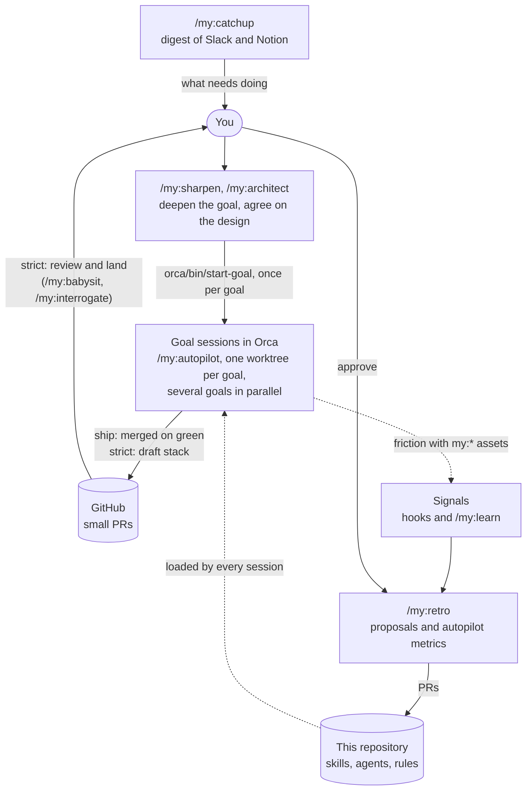
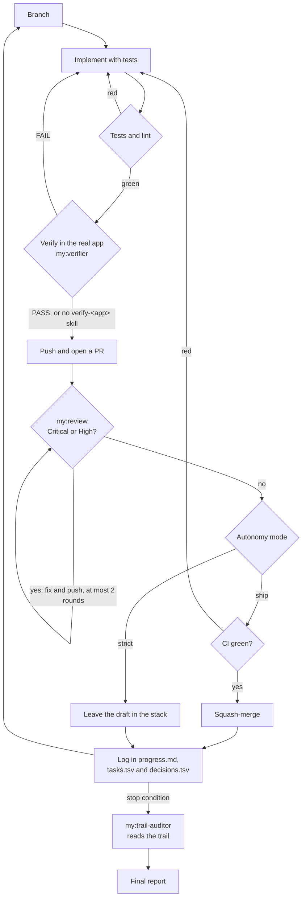

# my — personal Claude Code toolkit

A Claude Code **plugin** for working with autonomous agents: a review skill
with a diff review screen, an independent verifier agent, adversarial and
trail-audit agents, code-reading skills (how / why / blast-radius), skills
for before (sharpen / architect) and after (babysit / interrogate) a change,
a generator and upkeep pass for app verification skills, a guard hook for
pushes and outbound text, PdM skills, a session-knowledge loop
(learn / retro / eval-skill), working principles, and path-triggered
language rules.
The same repository also loads in Google Antigravity as a plugin (see
[Antigravity](#antigravity)).

## How work flows

You decide what to work on and land the results; agents do the work in
between. Each goal runs as `/my:autopilot` in its own Orca worktree and
session, so several goals move at once. What goes wrong with the toolkit
along the way comes back as signals that `/my:retro` turns into edits of this
repository, with your approval.



Inside a goal, autopilot runs each task through the same loop and logs it in
`~/.local/state/autopilot/<owner>-<name>/<goal>/`: `progress.md` for the human
reader, `decisions.tsv` (one row per decision on your behalf) and `tasks.tsv`
(one row per finished task, read by `/my:retro`). Improvements noticed outside
a task go to the repository's shared `found.md`. It never asks; it stops on the
conditions in `skills/autopilot/SKILL.md` §3 (done criteria observed, budget
spent, the same failure twice, BLOCKED), has `my:trail-auditor` read the trail,
and writes a final report.



Where each role runs depends on the machine. `orca/profiles/<name>.conf`
picks the harness and model per role.

| Role | Work machine (Claude Code) | Private machine (Antigravity) |
|------|----------------------------|-------------------------------|
| implement | `start-goal` session | `start-goal` session |
| verify, review | Subagents of the goal's session | Subagents from the `my-agents` plugin |
| adversary, audit | Subagents (`my:adversary` for `/my:interrogate`, `my:trail-auditor` for autopilot's final report) | Subagents from the `my-agents` plugin |

Guardrails:

- The outbound guard denies pushes to the default branch and force-pushes, and
  keeps strict repositories to draft PRs ([Autonomy modes](#autonomy-modes)).
- A goal's session cannot reach Slack or Notion: `start-goal` denies them in
  the worktree's local settings, and for Antigravity also through a
  PreToolUse hook in the worktree's `.agents/hooks.json`.
- In a repository with a `verify-<app>` skill, start one goal at a time:
  verify runs one app stack, and nothing stops two goals from verifying at
  once.

## Skills

| Skill | Purpose | Output |
|-------|---------|--------|
| `/my:autopilot` | Work toward a goal unattended: small PRs, each verified, AI-reviewed and fixed; merged on green in ship mode, stacked as drafts otherwise | PRs + `~/.local/state/autopilot/` log |
| `/my:review` | Checklist review of specs/plans/code/commits/PRs/PRDs | `docs/reviews/{type}/` |
| `/my:how` | Explain how part of a codebase works before changing it | answer with file references |
| `/my:why` | Explain why code is the way it is, from the commit and PR record | answer with citations |
| `/my:blast-radius` | Find what a change could break outside its diff, and prove it safe by running code | report |
| `/my:create-verification-skill` | Generate a `verify-<app>` skill that launches an app and drives it like a user | `.claude/skills/verify-<app>/` |
| `/my:maintain-verification-skill` | Check a `verify-<app>` skill and its feature map against the source and the live app, and fix the drift | one PR (repository skill) or a diff (personal skill) |
| `/my:sharpen` | Deepen a task before it starts: what an expert would also check, the rawest sources, the methods, an objective bar; does not do the task | rewritten request + goal text for `/my:autopilot` |
| `/my:architect` | Trace a boundary-crossing change, sketch two designs, compare them on state ownership and canonical paths; writes no code | design + recommendation |
| `/my:babysit` | Take an open PR to merge-ready: base drift, then review threads, then CI; never rebases, force-pushes or merges | report, fix commits, thread replies |
| `/my:interrogate` | Isolated `my:adversary` breakers attack a change in a throwaway worktree; only findings you rerun and reproduce survive | report |
| `/my:correct` | Turn mistakes agents keep repeating in a repository into structural checks (architecture, types, lint, tests) | PR in the target repository |
| `/my:worktree-cleanup` | Audit git and Orca worktrees and remove the merged or abandoned ones after your approval | audit table, removals |
| `/my:eval-skill` | Blind A/B evaluation of a skill, rule or agent change, judged against a hidden rubric and checked against the transcripts | Promote / Revise / Drop |
| `/my:learn` | Capture a toolkit improvement signal to the machine-local journal | `~/.claude/my-toolkit/journal/` |
| `/my:retro` | Cluster signals, propose toolkit edits, open a PR for each approved one | PRs to the toolkit repo (approval-gated) |
| `/my:pdm-setup` | One-time config for the PdM skills (workspace, backlog destination, channels) | `~/.claude/my-toolkit/pdm/config.md` |
| `/my:prd` | PRD from Slack/Notion context + bounded interview, self-checked | `{workspace}/docs/prd/` |
| `/my:product-spec` | PRD → 機能仕様 (edge-case sweep, Given/When/Then AC) | `{workspace}/docs/product-specs/` |
| `/my:backlog` | Spec/PRD → tickets; approval-gated filing to Notion DB / GitHub Issues | tickets + `{workspace}/docs/backlog/` |
| `/my:catchup` | Slack + Notion digest since last run (mentions, decisions, meeting action items) | `{workspace}/docs/catchup/` |

`/my:autopilot`, `/my:create-verification-skill`,
`/my:maintain-verification-skill`, `/my:sharpen`, `/my:architect`,
`/my:babysit`, `/my:interrogate`, `/my:correct`, `/my:worktree-cleanup`,
`/my:retro` and `/my:eval-skill` set `disable-model-invocation`:
the model never starts them on its own, so call them by name.

Language rules (`skills/rules-{go,rails,react,typescript}/`) load
automatically when matching files are read — no invocation needed.

## Agents

| Agent | Role |
|-------|------|
| `my:reviewer` | Runs `/my:review` in an isolated context |
| `my:diff-reviewer` | Plan-blind first pass of a two-pass diff review |
| `my:verifier` | Independent judge: runs the repo's `verify-<app>` skill against a checkout and returns PASS / FAIL / BLOCKED with evidence; never edits code |
| `my:adversary` | Breaker for `/my:interrogate`: runs commands in a throwaway worktree and returns `FINDINGS <n>` with only the bugs a command proved; never edits code |
| `my:trail-auditor` | Read-only audit of an autopilot run's `goal.md`, `decisions.tsv` and `tasks.tsv`: returns `reviewed by` and an `## Attention` section |

## Hooks

| Event | Script | Purpose |
|-------|--------|---------|
| `PreToolUse` | `outbound-guard.sh` | Denies force-pushes and pushes to the default branch; in strict repos also non-draft PRs, marking a PR ready and merging; blocks local paths, review IDs and untracked `docs/` paths in commit messages, PR/issue text, `gh api` writes (fields, piped bodies and `--input` files) and Notion writes |
| `SessionEnd` | `session-end.sh` | Appends a session index for `/my:retro` |
| `UserPromptSubmit` | `prompt-capture.sh` | Queues corrections for `/my:retro` |

These are Claude Code hooks (`hooks/hooks.json`). Antigravity reads the root
`hooks.json` instead, which runs `outbound-guard.sh` on `run_command` through
`antigravity-guard.sh`.

## Autonomy modes

Every repository is **strict** unless the machine-local
`~/.claude/my-toolkit/autonomy.conf` opts it into **ship** with a line
`ship <owner/name glob>`. Strict keeps PRs as drafts for a human to land;
ship lets the agent open normal PRs and merge them once CI is green.
`scripts/lib/autonomy.sh <dir>` prints a checkout's mode. The config stays
off the repository so it never names private repositories.

### Setup for `/my:autopilot`

1. Opt repositories into ship mode (skip for strict-only use):

   ```bash
   echo 'ship <your-github-user>/*' >> ~/.claude/my-toolkit/autonomy.conf
   ```

2. Allow the commands an unattended run needs, so it does not stall on a
   permission prompt. Put them in a **local, uncommitted** settings file:
   `~/.claude/settings.local.json` (every repository) or a repository's
   `.claude/settings.local.json` (that repository only). Never put them in a
   committed `.claude/settings.json`: that would let the agent merge PRs for
   everyone who clones the repository.

   ```json
   {
     "permissions": {
       "allow": [
         "Bash(gh pr create *)",
         "Bash(gh pr merge *)",
         "Bash(gh run list *)",
         "Bash(gh run watch *)",
         "Bash(gh run view *)",
         "Bash(git worktree *)"
       ]
     }
   }
   ```

   These allows are safe in strict repositories only because
   `outbound-guard.sh` still denies merges and non-draft PRs there. With the
   allows at the user level, keep the plugin's hooks enabled.

3. Give the repository a `verify-<app>` skill (`/my:create-verification-skill`)
   on its default branch, so each task can be verified in the real app.
   Without one, autopilot records every task as unverified.

## Rules

`rules/*.md` are working principles that apply in every session. Plugins
cannot ship rules, so `install.sh` links each file into `~/.claude/rules/`,
except the two Antigravity-only files:

- `rules/AGENTS.md` is a symlink to `principles.md`. Antigravity loads a
  plugin's `rules/AGENTS.md` as an always-on rule. The principles themselves
  carry no frontmatter, because Claude Code stops loading a rule whose
  frontmatter has no `paths`.
- `rules/antigravity.md` tells Antigravity how to read the Claude Code terms in
  the skills (`${CLAUDE_SKILL_DIR}`, `$ARGUMENTS`, tool names, agent launches).

## Installation

```bash
git clone https://github.com/naoking158/custom-slash-command.git
cd custom-slash-command
./scripts/install.sh
```

The installer creates these symlinks and cleans up symlinks from the old
(pre-plugin) layout:

| Path | State |
|------|-------|
| `~/.claude/skills/my` → `<repo>` | created (skills-directory plugin, referenced in place — repo edits apply live) |
| `~/.gemini/config/plugins/my` → `<repo>` | created (Antigravity plugin, referenced in place) |
| `~/.gemini/config/plugins/my-agents` → `<repo>/antigravity-agents` | created (the agents as Antigravity subagents) |
| `~/.gemini/antigravity-cli/settings.json` | when Antigravity is present, the allow rules of `orca/settings/agy.permissions.json` added to `permissions.allow` (see [Antigravity](#antigravity)) |
| `~/.claude/rules/<f>.md` → `<repo>/rules/<f>.md` | created, one per rules file except `AGENTS.md` and `antigravity.md` |
| `~/.prompts`, `~/.claude/commands`, `~/.claude/agents` | removed if they point into this repo (legacy layout) |

Restart Claude Code (or `/reload-plugins`) and start a new Antigravity
conversation after installing. After `git pull`, run `install.sh` again: a
new link or rule takes effect only then. Verify with
`./scripts/install.sh --check`; remove with `--uninstall`. The installer
never overwrites real files or foreign symlinks (`--force` retargets a stray
symlink).

## Antigravity

The repository is also an Antigravity plugin: `.antigravity-plugin/plugin.json`
names it `my`, so the skills keep their `my:<skill>` names. `install.sh` links
it into `~/.gemini/config/plugins/`.

| Part | In Antigravity |
|------|----------------|
| Skills | Load from `skills/`; `rules/antigravity.md` maps the Claude Code terms |
| `rules/principles.md` | Always on, through `rules/AGENTS.md` |
| Outbound guard | Root `hooks.json` → `antigravity-guard.sh` on `run_command` and on the input `manage_task` sends to a background command. The guard's `ask` becomes `force_ask`; the Notion write check is not wired |
| Agents | `agents/` keeps Claude Code tool names and stays hidden from Antigravity (`mainAgent: false`, `subagent: false`). `antigravity-agents/` (installed as the `my-agents` plugin) offers each one as an Antigravity subagent of the same name with Antigravity tool names, whose instructions are the `agents/` file; a step that launches an agent starts it with `invoke_subagent`. When the subagent cannot start, the step runs in the same conversation with the result marked `非隔離`, and diff-reviewer's plan-blind first pass is skipped |
| `/my:autopilot` | Runs on Antigravity, started by `start-goal` with an `antigravity` implement line |
| `/my:retro --deep` | `skills/retro/scripts/transcript-digest.sh` reads Antigravity transcripts as well as Claude Code ones |
| `/my:eval-skill` | Runs its variants with `agy -p --settings <allow rules>` in homes made by `scripts/lib/agy-home.sh` |
| Personal skills | Written to `~/.agents/skills/`, which Antigravity loads (it does not load `.claude/skills/`) |
| `SessionEnd` / `UserPromptSubmit` capture | Root `hooks.json` → `antigravity-stop.sh` on `Stop`: it indexes the conversation on its first turn and passes each new input to `prompt-capture.sh` |

Approvals. Antigravity asks before a command it cannot run inside its
terminal sandbox and before writing outside the workspace, which stops
unattended work. `install.sh` adds narrow allow rules for ordinary commands
(git, gh queries, draft PRs, test runners, read-only commands), for
autopilot's state directory and agy's own conversation folders, and on a nix
machine for reading the nix store (the sandbox's shell lives there; without it
every command leaves the sandbox). A hook's `allow` does not approve anything
in Antigravity, so these are settings rules. The outbound guard's deny and
`force_ask` still win over them, and commands outside the rules go to
Antigravity's own check.

Models. `orca/profiles/private.conf` gives the Antigravity models:
gemini-4-neon-medium for implementing and checking, gemini-4-hydrogen-high
for research and simple tasks (`scout`), and gemini-4-carbon-medium for a spot
consultation on a hard task (`consult`).

These were checked with agy 1.5.18 by running it.
`scripts/agy-smoke/run.sh` runs every skill once with `agy -p` against a
throwaway repository and lists the ones that stop, are denied a tool, or act
on Claude Code terms. To check the installation:

```bash
agy plugin validate ~/.gemini/config/plugins/my
agy plugin list        # my should be enabled, with my:* skills
```

## Orca

`orca/` runs roles in their own context through [Orca](https://orca.dev)
orchestration workers. Nothing here is needed without an `orca` command.
When `orca` is on PATH, `install.sh` and `--check` confirm that
`orca/bin/doctor` is executable and that a profile is selected, and fail
otherwise.

- `orca/bin/doctor`: run from an Orca terminal; checks that Orca is reachable
  and that both guards deny a push to `main`.
- `orca/bin/start-goal [--name <name>] [--profile <profile>] <repo> "<goal>"`: creates an Orca
  worktree of `<repo>` from origin's default branch, adds the deny rules of
  `orca/settings/goal.deny.json` to its `.claude/settings.local.json` (the
  Slack and Notion MCP servers it names, and `orca slack`), marks it as the
  goal's worktree for autopilot, and then launches `/my:autopilot <goal>` there
  with the profile's `implement` agent and model. The `implement` harness is
  `claude` or `antigravity`; for Antigravity it also registers
  `scripts/hooks/antigravity-goal-deny.sh`, which applies the same deny rules,
  in the worktree's `.agents/hooks.json`. `--profile` picks the profile for
  this goal only. Run one per goal to
  work on several goals at once. Start at most one goal at a time in a
  repository with a `verify-<app>` skill: verify runs one app stack, and
  nothing stops two goals from verifying at once. `<repo>` must be registered
  in Orca (`orca repo add --path <repo>`). Exit codes: 0 launched and the
  prompt started a turn, 2 configuration error, 3 Orca unusable or no turn
  seen to start. In that last exit-3 case the worktree and session are kept,
  and stderr names the terminal handle and the command that sends the
  prompt by hand; in the others a worktree already made is removed.
- `orca/profiles/<name>.conf`: the harness and model per role, one
  `<role> <harness> <model>` line each. start-goal reads the `implement`
  line; the agents run as subagents of the goal's session and use its model,
  so the other lines record the intended model for each role. The values for
  each machine are in `orca/profiles/work.conf` and
  `orca/profiles/private.conf`; read the comments in each file before relying
  on a model choice.
- A profile must be selected on any machine with `orca` on PATH: set
  `MY_ORCA_PROFILE`, or write a `profile <name>` line in
  `~/.claude/my-toolkit/orca.conf` (`profile work` on the work machine,
  `profile private` on the private one). Without one, start-goal cannot pick
  the harness and model of a goal; `install.sh --check` reports it.

## Usage

### PdM flow

```bash
/my:pdm-setup                          # 初回のみ: workspace / 起票先 / チャンネル
/my:catchup                            # 朝: 前回以降の Slack+Notion ダイジェスト
/my:prd "価格アラート機能"              # PRD ドラフト (インタビュー → 自己チェック)
/my:review prd:20260711-price-alert    # PRD checklist review
/my:product-spec 20260711-price-alert  # 機能仕様 (エッジケース網羅 + AC)
/my:review pspec:20260711-price-alert
/my:backlog 20260711-price-alert       # 分解 → 承認 → 起票 (Notion/GitHub)
/my:backlog quick "CSV出力が文字化けする" # 単発起票
```

PdM artifacts live in a dedicated workspace directory (configured by
`/my:pdm-setup`) so `prd:`/`pspec:` review targets resolve when run from it.
Ticket filing and Notion publishing are always draft-first and
approval-gated. Scheduled digests: see `scripts/pdm/README.md`
(claude.ai cloud routine = full Slack+Notion; local launchd = Notion-only).

### Review

```bash
/my:review spec:20260705-user-auth      # → docs/reviews/specs/20260705-user-auth.md
/my:review be:plan:20260705-user-auth   # → docs/reviews/plans/20260705-user-auth--be.md
/my:review code:20260705-user-auth      # reviews the diff for that work
/my:review commit:abc1234
/my:review pr:current
/my:review code:20260705-user-auth --no-screen   # markdown only
```

Perspectives: `fe:` `be:` `security:` `perf:` `doc:` `maint:`.
Severity scale (toolkit-wide): **Critical / High / Medium / Low**; only
Critical/High gate the assessment. Assessment is PASS or NEEDS_REVISION.

**Diff targets** (`code:` / `commit:` / `pr:`) additionally produce
`{id}.html` — a self-contained review screen you open with `file://` — and
`{id}.json`, the data both it and the report are generated from. The screen
shows the diff grouped by intent in risk order, with an explanation per group;
you approve group by group, triage each finding as 採用 / 却下, comment on any
line, and then generate one Markdown to paste back into the session that wrote
the code. Approval state lives in `localStorage` and is discarded when the
diff changes.

When the target has something to be deferential to — a plan, a spec, a commit
message, a PR body — the review runs **two passes**: a subagent reviews the
diff blind to all of it, then the main pass reconciles those findings against
the plan. A first-pass finding can be downgraded or marked as intentional, but
never dropped; that is machine-checked. Without such context there is nothing
to defer to, so it runs a single pass.

`--no-screen` restores the markdown-only behavior. Doc targets are unchanged.
`{id}.html` and `{id}.json` are gitignored as regenerable build artifacts.

### Improvement loop (learn / retro)

The toolkit improves itself through a capture-then-promote loop. Capture is
cheap and automatic; promotion is deliberate and approval-gated.

**Division of labor with native features** — project knowledge (facts about
the codebase you're working in) belongs to Claude Code's native auto memory;
`/insights` covers monthly workflow retrospectives. This loop handles the one
thing native features don't: **evidence that this toolkit's own assets should
change**, promoted into real edits of this repo.

```
[hooks]      SessionEnd → session index; UserPromptSubmit → correction queue
[/my:learn]  explicit capture: "this my:* asset misbehaved / is missing X"
[/my:retro]  cluster → classify (skill edit / rule / new skill / hook /
             CLAUDE.md) → propose diffs → open a PR per approved one →
             archive promoted signals, prune stale ones
```

```bash
/my:learn --category mistake --target skills/review "Medium の指摘を落とした"
/my:retro                 # cluster + propose + PRs (with approval)
/my:retro --dry-run       # report only: fetches origin, moves no checkout
/my:retro --deep          # also mine transcripts before their ~30-day expiry
```

`/my:retro` also reports autopilot metrics for the last 28 days (review rounds per change, verify outcomes, human pushback on `auto/` PRs, reverts of `auto/` PRs), counted by `skills/retro/scripts/autopilot-metrics.sh`.

All captured data is machine-local under `~/.claude/my-toolkit/` (journal
entries, `sessions.jsonl`, `corrections.jsonl`) and never enters a project
tree. `/my:retro` resolves the toolkit repo via `$CLAUDE_TOOLKIT_REPO`,
plugin env vars, or the `~/.claude/skills/my` symlink — never the current
directory. Text promoted into the repo passes `redact.sh` first.

## Repository structure

```
custom-slash-command/
├── .claude-plugin/plugin.json     # plugin manifest (namespace "my")
├── .antigravity-plugin/plugin.json # Antigravity plugin manifest (name "my")
├── skills/                        # one directory per skill (SKILL.md + assets)
│   ├── review/                    # + template.md, checklists/, review-json.md,
│   │                              #   scripts/ (diff-hunks, build-screen, render-report),
│   │                              #   assets/review-screen.html
│   ├── autopilot/                 # + goal-template.md, scripts/ (log-decision, log-task)
│   ├── how/  why/  blast-radius/
│   ├── sharpen/  architect/       # before a change
│   ├── babysit/  interrogate/     # after a change; babysit + references/bot-triage.md
│   ├── create-verification-skill/ # + references/
│   ├── maintain-verification-skill/  correct/  worktree-cleanup/  eval-skill/
│   ├── prd|product-spec|backlog|catchup/           # PdM flow, each with template.md
│   ├── learn/  pdm-setup/
│   ├── retro/                     # + scripts/redact.sh, redact.denylist
│   └── rules-{go,rails,react,typescript}/          # SKILL.md index + references/
├── agents/                        # reviewer, diff-reviewer, verifier, adversary, trail-auditor
├── rules/                         # working principles, linked into ~/.claude/rules/;
│                                  #   AGENTS.md, antigravity.md for Antigravity only
├── hooks/hooks.json               # PreToolUse guard, SessionEnd index, UserPromptSubmit capture
├── hooks.json                     # Antigravity: PreToolUse guard on run_command
├── orca/                          # bin/doctor, bin/start-goal, lib/profile.sh, profiles/ (work, private), settings/goal.deny.json
├── scripts/                       # install.sh, lib/, hooks/, pdm/ (scheduling)
├── tests/                         # bats: hooks / install / orca / redact / review-screen / toolkit
└── docs/                          # design notes and reviews of this repo itself
```

Design rules the repo follows:

- **One source of truth per skill**: all behavior lives in the skill's
  `SKILL.md`; agents are thin shells that preload the skill and define the
  return contract; templates/checklists sit next to their skill.
- **Naming**: outputs are `YYYYMMDD-{kebab-case-identifier}.md`; placeholders
  are single-brace `{id}`.
- Forked skills (review) never ask questions and record assumptions instead.
- Third-party content keeps its license notice in `THIRD_PARTY_NOTICES.md`.

## Development

The tests come in two parts. The bats suites under `tests/` test the scripts and hooks as processes. The Go tests in `internal/outboundguard/` test the rules of outbound-guard in process; those rules have no bats tests, so a run of bats alone does not check them. The tools (bats, Go, shellcheck) are pinned in `mise.toml`.

```bash
tests/all-parallel.sh       # every test once: bats suites in parallel and go test at the same time
tests/run.sh                # the CI gate: bats under the bash on PATH and under /bin/bash, then go test
tests/parallel.sh [FILE]... # bats suites only, in parallel (default: tests/)
go test ./...               # Go tests only
mise run lint               # shellcheck, go vet, gofmt, and a check that bin/ is built from the source
./scripts/install.sh --check
```

`tests/all-parallel.sh` is for iterating; it uses only the bash on PATH. Run `tests/run.sh` (or `mise run test`) before a pull request: macOS hooks run under `/bin/bash` 3.2, and only that script runs the bats suites under it. After changing `cmd/` or `internal/`, rebuild the committed binaries with `scripts/build-bin.sh`.

## License

MIT
