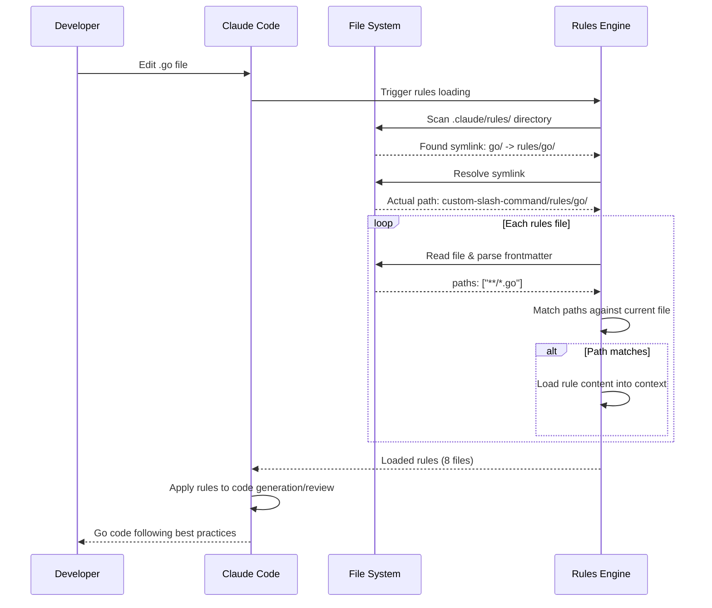
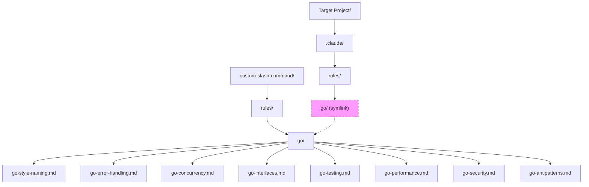
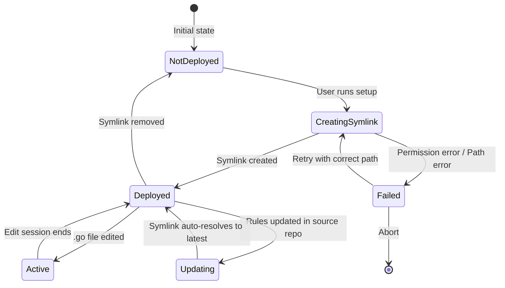

# Specification: Go Coding Rules for Claude Code

## 1. Overview

### 1.1 Purpose

Go 言語のコーディングベストプラクティスを Claude Code の rules として体系化し、`.go` ファイル編集時に自動ロードされる仕組みを構築する。公式ガイドライン（Effective Go, Go Code Review Comments, Google/Uber Style Guide）をベースに、具体的かつアクション可能なルール群を提供する。

### 1.2 Scope

| In Scope | Out of Scope |
|----------|--------------|
| Go 言語のベストプラクティス rules 作成（8 カテゴリ） | 他言語（Python, TypeScript 等）の rules |
| `rules/go/` ディレクトリ構造の構築 | プロジェクト固有のカスタムルール |
| `paths: ["**/*.go"]` による自動スコープ設定 | レビュー専用ルールの分離 |
| シンボリックリンクによる配備構造の設計 | 配備自動化スクリプトの実装 |
| 各ファイル 200 行以下の制約遵守 | Go バージョン依存ルールの動的切替 |

### 1.3 References

- Research Document: `docs/research/20260406-go-coding-rules.md`
- Effective Go: https://go.dev/doc/effective_go
- Go Code Review Comments: https://github.com/golang/go/wiki/CodeReviewComments
- Google Go Style Guide: https://google.github.io/styleguide/go/
- Uber Go Style Guide: https://github.com/uber-go/guide/blob/master/style.md

---

## 2. User Stories

### US-001: Go コード生成時のベストプラクティス自動適用

**As a** Go 開発者（Claude Code ユーザー）
**I want** `.go` ファイルを編集する際に Go のベストプラクティスが自動的に参照されたい
**So that** 慣用的で高品質な Go コードを一貫して生成できる

**Acceptance Criteria:**
- [ ] AC-001: `rules/go/` ディレクトリに 8 つのカテゴリ別 rules ファイルが存在する
- [ ] AC-002: 各ファイルに `paths: ["**/*.go"]` フロントマターが設定されている
- [ ] AC-003: `.go` ファイル編集時にルールが自動ロードされる
- [ ] AC-004: 各ファイルが 200 行以下である

### US-002: シンボリックリンクによる他プロジェクトへの配備

**As a** チームリード
**I want** rules を一元管理し、各プロジェクトにシンボリックリンクで配備したい
**So that** プロジェクト横断で一貫した品質基準を適用できる

**Acceptance Criteria:**
- [ ] AC-001: `rules/go/` ディレクトリ単位でシンボリックリンク可能な構造になっている
- [ ] AC-002: シンボリックリンク経由で Claude Code がルールを正しくロードできる
- [ ] AC-003: 配備手順がドキュメント化されている

### US-003: カテゴリ別のルール管理

**As a** 開発者
**I want** ルールがカテゴリごとに分割されていてほしい
**So that** 特定のトピック（エラーハンドリング等）のルールを個別に参照・更新できる

**Acceptance Criteria:**
- [ ] AC-001: 各カテゴリが独立したファイルとして管理されている
- [ ] AC-002: ファイル名からカテゴリが識別可能（`go-error-handling.md` 等）
- [ ] AC-003: カテゴリ間に不要な依存関係がない

### US-004: レビュー時のベストプラクティス自動検出

**As a** レビュアー
**I want** レビュー時に Go の規約違反が自動的に検出・指摘されてほしい
**So that** レビュー品質が向上し、見落としを防げる

**Acceptance Criteria:**
- [ ] AC-001: ルールが「するべきこと」と「避けるべきこと」の両方を含む
- [ ] AC-002: アンチパターンが具体的なコード例とともに記載されている
- [ ] AC-003: 各ルールに修正方法・推奨パターンが含まれている

---

## 3. Rules File Interface

### 3.1 File Format

各 rules ファイルは以下の形式に従う:

```markdown
---
paths:
  - "**/*.go"
---

# {Category Title}

## {Section}

### DO: {Good Practice}
- Description of the practice
- Code example (if applicable)

### DON'T: {Anti-pattern}
- Description of what to avoid
- Why it's problematic
```

### 3.2 YAML Frontmatter

```yaml
---
paths:
  - "**/*.go"
---
```

- `paths` は必須。全 Go ファイルに適用するため `"**/*.go"` を使用
- 将来的にテストファイル専用ルールを作る場合は `"**/*_test.go"` も可能

---

## 4. Data Models

### 4.1 Entity: RulesFile

| Field | Type | Required | Description |
|-------|------|----------|-------------|
| filename | string | Yes | ファイル名（`go-{category}.md`） |
| category | enum | Yes | style-naming \| error-handling \| concurrency \| interfaces \| testing \| performance \| security \| antipatterns |
| paths | string[] | Yes | 適用対象のファイルパターン |
| content | string | Yes | ルール本文（Markdown） |
| lineCount | number | Yes | 行数（200 以下） |

### 4.2 Entity: RulesDirectory

| Field | Type | Required | Description |
|-------|------|----------|-------------|
| language | string | Yes | 言語名（`go`） |
| basePath | string | Yes | `rules/go/` |
| files | RulesFile[] | Yes | 配下の rules ファイル群 |

### 4.3 Entity: SymlinkDeployment

| Field | Type | Required | Description |
|-------|------|----------|-------------|
| source | string | Yes | `{repo}/rules/go/` |
| target | string | Yes | `{project}/.claude/rules/go` |
| type | string | Yes | directory symlink |

---

## 5. System Flow

### 5.1 Sequence Diagram - Rules Loading Flow



### 5.2 Directory Structure Diagram



### 5.3 State Diagram - Symlink Deployment



---

## 6. Rules Categories Specification

### 6.1 go-style-naming.md (P0)

**Purpose:** 命名規則、パッケージ構成、フォーマットに関するルール

**Key Topics:**
- `MixedCaps` / `mixedCaps` の命名規則（アンダースコア非推奨）
- パッケージ名: 短く、小文字、単数形（`util` ではなく具体的な名前）
- エクスポート名の接頭辞にパッケージ名を含めない（`http.HTTPServer` → `http.Server`）
- レシーバー名: 短く一貫した 1-2 文字（`self`/`this` 禁止）
- インターフェース名: `-er` サフィックス（`Reader`, `Writer`）
- アクロニムは全大文字（`URL`, `HTTP`, `ID`）
- `gofmt` / `goimports` によるフォーマット強制
- ファイル構成: 1 パッケージ 1 ディレクトリ

### 6.2 go-error-handling.md (P0)

**Purpose:** エラーハンドリングのパターンとベストプラクティス

**Key Topics:**
- エラーは常にチェック（`_ = someFunc()` 禁止）
- `fmt.Errorf("context: %w", err)` によるエラーラッピング
- Sentinel errors: `var ErrNotFound = errors.New("not found")`
- カスタムエラー型の定義パターン
- `errors.Is()` / `errors.As()` によるエラー検査
- エラーメッセージ: 小文字開始、句点なし
- `panic` は本当に回復不能な場合のみ
- `defer` でのリソースクリーンアップ

### 6.3 go-concurrency.md (P1)

**Purpose:** goroutine、チャネル、sync プリミティブの安全な使用

**Key Topics:**
- goroutine リーク防止: `context.Context` による制御
- チャネルの方向指定（`chan<-`, `<-chan`）
- `sync.WaitGroup` パターン
- `sync.Mutex` vs `sync.RWMutex` の使い分け
- `select` + `context.Done()` パターン
- `errgroup.Group` による並行エラーハンドリング
- データ競合の回避（`-race` フラグでのテスト）
- goroutine のライフサイクル管理

### 6.4 go-interfaces.md (P1)

**Purpose:** インターフェース設計のベストプラクティス

**Key Topics:**
- 小さいインターフェース（1-3 メソッド推奨）
- 消費者側でインターフェースを定義（producer 側ではなく）
- `Accept interfaces, return structs` 原則
- 空インターフェース `interface{}` / `any` の使用を最小化
- インターフェースの合成（embedding）
- 標準ライブラリのインターフェースパターン（`io.Reader`, `fmt.Stringer`）
- 不要な抽象化の回避

### 6.5 go-testing.md (P1)

**Purpose:** テストのベストプラクティス

**Key Topics:**
- Table-driven tests パターン
- `t.Run()` によるサブテスト
- `t.Helper()` の使用
- `t.Parallel()` による並列テスト
- テストヘルパー関数の設計
- `testdata/` ディレクトリの活用
- モック: インターフェースベースの注入
- `testing/fstest`, `net/http/httptest` 等の標準テストユーティリティ
- ゴールデンファイルテスト

### 6.6 go-performance.md (P2)

**Purpose:** パフォーマンスに関するガイドライン

**Key Topics:**
- 計測なき最適化の禁止（`pprof` 使用推奨）
- `strings.Builder` による文字列結合
- スライスの事前確保（`make([]T, 0, cap)`）
- `sync.Pool` によるオブジェクト再利用
- ポインタ vs 値レシーバーの使い分け
- 不要なメモリアロケーションの回避
- `range` ループでの値コピーへの注意（Go 1.22+ で改善）
- バッファリング I/O（`bufio`）

### 6.7 go-security.md (P1)

**Purpose:** セキュリティに関するルール

**Key Topics:**
- SQL インジェクション防止: プレースホルダー使用必須
- コマンドインジェクション防止: `exec.Command` の引数分離
- パストラバーサル防止: `filepath.Clean` + 検証
- `crypto/rand` 使用（`math/rand` はセキュリティ用途に使わない）
- HTTPS 強制、TLS 設定
- 入力バリデーション
- 機密情報のログ出力禁止
- `html/template`（XSS 防止）vs `text/template`

### 6.8 go-antipatterns.md (P2)

**Purpose:** 避けるべきパターン集

**Key Topics:**
- `init()` 関数の濫用
- グローバル変数への依存
- `interface{}` の過度な使用
- エラーの握りつぶし（`_ = err`）
- 過度のチャネル使用（mutex で十分な場面）
- 巨大な関数・パッケージ
- 不適切なコンテキスト伝搬（`context.Background()` の乱用）
- `goto` 文の使用
- 不要な else ブロック（early return 推奨）

---

## 7. Edge Cases & Error Handling

| Scenario | Expected Behavior |
|----------|-------------------|
| シンボリックリンクが切れている | Claude Code がルールロード失敗 → エラーログに記録 |
| 200 行を超える rules ファイル | 作成時にチェックし分割を促す |
| 複数プロジェクトで異なるバージョンの rules を使用 | シンボリックリンクの向き先で制御 |
| `.go` 以外のファイル編集時 | rules はロードされない（paths 指定による） |
| `go.mod` / `go.sum` 編集時 | Go rules はロードされない（`**/*.go` にマッチしない） |
| テストファイル（`*_test.go`）編集時 | 全 Go rules がロードされる（testing rules 含む） |

---

## 8. Deployment Guide

### 8.1 Source Repository Structure

```
custom-slash-command/
└── rules/
    └── go/
        ├── go-style-naming.md
        ├── go-error-handling.md
        ├── go-concurrency.md
        ├── go-interfaces.md
        ├── go-testing.md
        ├── go-performance.md
        ├── go-security.md
        └── go-antipatterns.md
```

### 8.2 Symlink Deployment

```bash
# Target project に Claude Code rules ディレクトリを作成
mkdir -p /path/to/project/.claude/rules

# シンボリックリンクを作成
ln -s /path/to/custom-slash-command/rules/go /path/to/project/.claude/rules/go
```

### 8.3 Verification

```bash
# シンボリックリンクの確認
ls -la /path/to/project/.claude/rules/go

# ルールファイルの存在確認
ls /path/to/project/.claude/rules/go/
```

---

## 9. Quality Constraints

| Metric | Target | Measurement |
|--------|--------|-------------|
| ファイルあたり行数 | ≤ 200 行 | `wc -l` |
| ルールファイル数 | 8 ファイル | `ls rules/go/ \| wc -l` |
| パスマッチ精度 | 100% `.go` ファイルのみ | 手動検証 |
| 公式ガイドライン準拠 | Effective Go + Code Review Comments カバー率 90%+ | チェックリスト |

---

## 10. File Inventory

### 10.1 New Files to Create

| File | Lines (est.) | Priority | Description |
|------|-------------|----------|-------------|
| `rules/go/go-style-naming.md` | ~150 | P0 | 命名・スタイル規約 |
| `rules/go/go-error-handling.md` | ~180 | P0 | エラーハンドリング |
| `rules/go/go-concurrency.md` | ~170 | P1 | 並行処理 |
| `rules/go/go-interfaces.md` | ~120 | P1 | インターフェース設計 |
| `rules/go/go-testing.md` | ~160 | P1 | テスト |
| `rules/go/go-performance.md` | ~140 | P2 | パフォーマンス |
| `rules/go/go-security.md` | ~150 | P1 | セキュリティ |
| `rules/go/go-antipatterns.md` | ~130 | P2 | アンチパターン |

### 10.2 No Existing Files Modified

本仕様は新規ファイルの追加のみで、既存ファイルの変更は不要。

---

## 11. Testing Strategy

### 11.1 Format Validation
- 各ファイルの YAML フロントマターが正しいこと
- `paths` フィールドが `["**/*.go"]` であること
- 各ファイルが 200 行以下であること

### 11.2 Content Validation
- 各カテゴリのキートピックが網羅されていること
- コード例が構文的に正しい Go コードであること
- DO / DON'T が明確に区別されていること

### 11.3 Integration Validation
- シンボリックリンク経由で Claude Code がルールをロードできること
- `.go` ファイル編集時にルールが適用されること
- `.go` 以外のファイル編集時にルールが適用されないこと

---

## 12. Open Items

- [ ] レビュー専用ルールとコーディング専用ルールの分離が必要か（Q2）
- [ ] プロジェクト固有カスタマイズの上書き方法（Q3）
- [ ] Go バージョン依存ルール（1.22+ ループ変数等）の管理方法（Q4）
- [ ] 配備自動化スクリプトの要否（Q5）
- [ ] `go.mod` / `go.sum` 用のルールが必要か
- [ ] 将来の他言語追加時の共通パターン抽出

---

**Created:** 2026-04-06
**Last Updated:** 2026-04-06
**Status:** Draft
**Author:** Claude Code
