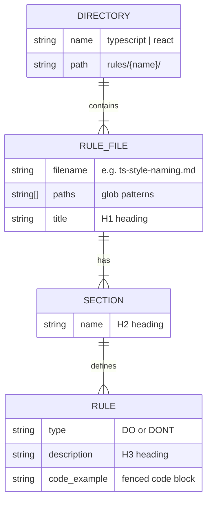
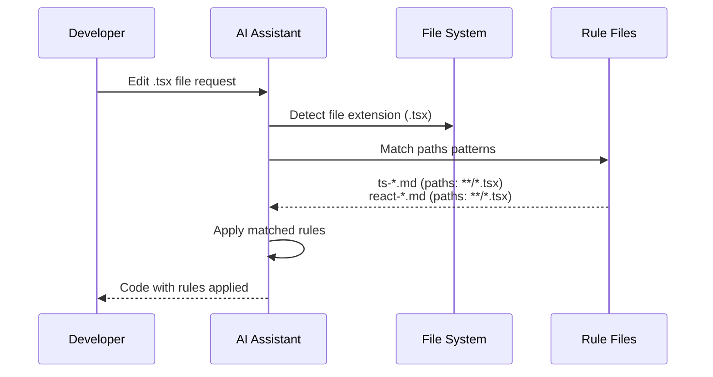
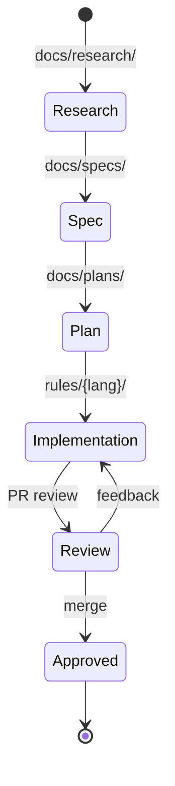

# Specification: TypeScript & React Coding Rules

## 1. Overview

### 1.1 Purpose
AI アシスタント（Claude Code 等）がコードレビュー・コード生成時に参照する、TypeScript および React のコーディングルールを整備する。既存の Go ルール（`rules/go/`）と同等の品質・構造・フォーマットで作成し、フロントエンド開発の一貫性と品質を担保する。

### 1.2 Scope

| In Scope | Out of Scope |
|----------|--------------|
| TypeScript 5+ のモダンパターン | ESLint / Prettier 設定 |
| React 18+ のベストプラクティス | Next.js / フレームワーク固有ルール |
| YAML frontmatter + DO/DON'T 形式 | Server Components 固有ルール（将来拡張） |
| セキュリティ（XSS, 入力バリデーション） | バックエンド Node.js ルール |
| アクセシビリティ基本ルール | デザインシステム / CSS ルール |

### 1.3 References
- Research Document: `docs/research/20260406-ts-react-rules.md`
- Go Rules (format reference): `rules/go/`

---

## 2. User Stories

### US-001: TypeScript ルールの参照
**As a** AI アシスタント
**I want** TypeScript コーディングルールを paths ベースで参照できる
**So that** `.ts` / `.tsx` ファイル編集時に適切なルールを適用できる

**Acceptance Criteria:**
- [ ] AC-001: 各ルールファイルに `paths: ["**/*.ts", "**/*.tsx"]` の YAML frontmatter がある
- [ ] AC-002: DO/DON'T パターンでコード例が提示されている
- [ ] AC-003: Go ルールと同一フォーマットで記述されている

### US-002: React ルールの参照
**As a** AI アシスタント
**I want** React 固有のコーディングルールを paths ベースで参照できる
**So that** `.tsx` ファイル編集時にコンポーネント設計・hooks・テストの指針を適用できる

**Acceptance Criteria:**
- [ ] AC-001: React ルールファイルに `paths: ["**/*.tsx"]` の YAML frontmatter がある
- [ ] AC-002: React 18+ のモダンパターン（hooks, composition）がカバーされている
- [ ] AC-003: Testing Library のベストプラクティスが含まれている

### US-003: セキュリティルールの適用
**As a** 開発者
**I want** フロントエンドセキュリティのルールを参照できる
**So that** XSS、不正入力、dangerouslySetInnerHTML 等のリスクを防止できる

**Acceptance Criteria:**
- [ ] AC-001: XSS 防止パターンが DO/DON'T 形式で記述されている
- [ ] AC-002: 外部入力の runtime validation（Zod 等）のパターンが含まれている
- [ ] AC-003: URL 検証、CSP の指針が含まれている

### US-004: コード品質の統一
**As a** チームメンバー
**I want** TypeScript/React の命名規則・アンチパターンが明文化されている
**So that** チーム全体でフロントエンドコードの品質と一貫性を保てる

**Acceptance Criteria:**
- [ ] AC-001: 命名規則（camelCase, PascalCase 等）が明確に定義されている
- [ ] AC-002: よくあるアンチパターン（any 乱用, useEffect 濫用等）が列挙されている
- [ ] AC-003: 各ルールファイルが 100-200 行程度で読みやすい

---

## 3. File Interface (API equivalent)

本プロジェクトは API ではなくルールファイルセットのため、ファイル構造とフォーマットを定義する。

### 3.1 YAML Frontmatter Schema

```yaml
---
paths:
  - "**/*.ts"    # TypeScript rules
  - "**/*.tsx"   # TypeScript + React rules
---
```

### 3.2 Rule File Format

```markdown
---
paths:
  - "{glob patterns}"
---

# {Category Title}

## {Section Name}

### DO: {Positive pattern description}

{Explanation}

\`\`\`typescript
// DO
{good code example}

// DON'T
{bad code example}
\`\`\`

### DON'T: {Anti-pattern description}

{Explanation of why this is bad}

\`\`\`typescript
// DON'T
{bad code example}

// DO - {correction description}
{good code example}
\`\`\`
```

### 3.3 File Inventory

#### TypeScript Rules (`rules/typescript/`)

| File | Description | paths |
|------|-------------|-------|
| `ts-style-naming.md` | 命名規則、ファイル構成、import 整理 | `**/*.ts`, `**/*.tsx` |
| `ts-type-system.md` | strict mode, generics, utility types, satisfies, discriminated unions | `**/*.ts`, `**/*.tsx` |
| `ts-error-handling.md` | Result 型, カスタムエラー, unknown catch | `**/*.ts`, `**/*.tsx` |
| `ts-async-patterns.md` | async/await, AbortController, Promise パターン | `**/*.ts`, `**/*.tsx` |
| `ts-antipatterns.md` | any 禁止, non-null assertion, namespace 等 | `**/*.ts`, `**/*.tsx` |

#### React Rules (`rules/react/`)

| File | Description | paths |
|------|-------------|-------|
| `react-components.md` | 関数コンポーネント, Props 型定義, composition, hooks | `**/*.tsx` |
| `react-state.md` | state 管理, useReducer, Context 分割, 派生値 | `**/*.tsx` |
| `react-performance.md` | memo, useMemo, useCallback, lazy, key | `**/*.tsx` |
| `react-testing.md` | Testing Library, role ベースクエリ, hook テスト | `**/*.tsx` |
| `react-security.md` | XSS, dangerouslySetInnerHTML, URL 検証, CSP | `**/*.tsx` |
| `react-accessibility.md` | セマンティック HTML, ARIA, キーボードナビ | `**/*.tsx` |

---

## 4. Data Models (Rule Content Structure)

### 4.1 Entity: Rule File

| Field | Type | Required | Description |
|-------|------|----------|-------------|
| paths | string[] | Yes | YAML frontmatter - 適用対象の glob パターン |
| title | string | Yes | H1 heading - ルールカテゴリ名 |
| sections | Section[] | Yes | H2 headings - ルールセクション |

### 4.2 Entity: Section

| Field | Type | Required | Description |
|-------|------|----------|-------------|
| name | string | Yes | セクション名（例: "Naming Rules"） |
| rules | Rule[] | Yes | DO/DON'T ルール群 |

### 4.3 Entity: Rule

| Field | Type | Required | Description |
|-------|------|----------|-------------|
| type | "DO" \| "DON'T" | Yes | ルールの種類 |
| description | string | Yes | ルールの説明 |
| code_example | string | Yes | コード例（DO/DON'T 両方含む） |
| rationale | string | No | 理由の補足説明 |

### 4.4 Entity Relationships



---

## 5. System Flow

### 5.1 Rule Application Flow



### 5.2 Rule Development Flow



---

## 6. Edge Cases & Error Handling

| Scenario | Expected Behavior |
|----------|-------------------|
| `.ts` ファイルに React ルールが適用される | paths が `**/*.tsx` のみのルールは `.ts` には適用しない |
| TypeScript と React のルールが矛盾する | React ルールがより具体的なため優先（例: Props 型定義） |
| ルールに該当しないパターンが出現 | 既存ルールの精神に基づき判断、必要に応じルール追加 |
| Server Components コードの編集 | 現時点ではスコープ外。将来 `react-server-components.md` で対応 |
| ルールファイルが 200 行を超える | セクション分割を検討し、別ファイルに分離 |

---

## 7. Security Considerations

### 7.1 XSS Prevention
- `dangerouslySetInnerHTML` には必ず DOMPurify 等のサニタイザーを適用
- ユーザー入力を直接 DOM に反映しない

### 7.2 Input Validation
- 外部入力（API レスポンス、URL パラメータ）は Zod 等で runtime validation
- `unknown` + type narrowing で型安全を確保

### 7.3 URL / Link Safety
- `href` に動的値を設定する場合、`javascript:` プロトコルを拒否
- 外部 URL は allowlist で検証

### 7.4 CSP Compliance
- インライン `style` / `script` の使用制限に関する指針を含める

---

## 8. Performance Requirements

| Metric | Target | Measurement Method |
|--------|--------|--------------------|
| ルールファイル行数 | 100-200 行/ファイル | `wc -l` |
| ルールファイル数 | 11 ファイル（TS 5 + React 6） | ファイル数カウント |
| コード例の実用性 | コピー可能な品質 | レビューによる確認 |
| Go ルールとの構造一致度 | 100% フォーマット互換 | フォーマット比較 |

---

## 9. Testing Strategy

### 9.1 Format Validation
- 各ルールファイルが YAML frontmatter を持つことを確認
- paths フィールドが有効な glob パターンであることを確認
- DO/DON'T パターンがコード例と共に存在することを確認

### 9.2 Content Review
- TypeScript コード例が `tsc --noEmit` で型チェックを通ること（理想）
- React コード例がモダンパターン（React 18+）に準拠していること
- Go ルールとのカテゴリ対応が網羅的であること

### 9.3 Coverage Check
- Research で特定された Top 10 重要ルールが全てカバーされていること：
  1. `strict: true` + `noUncheckedIndexedAccess` 必須
  2. `any` 禁止、`unknown` + type narrowing
  3. enum より `as const` + union literal type
  4. `satisfies` で型チェック + リテラル推論を両立
  5. 外部入力は Zod 等で runtime validation
  6. `React.FC` を使わず明示的 Props 型定義
  7. useEffect を state 同期に使わない
  8. Testing Library で role ベースクエリを優先
  9. `dangerouslySetInnerHTML` には DOMPurify 必須
  10. Server/Client Component の境界を意識する

---

## 10. Design Decisions

### DD-001: ディレクトリ構成 - `rules/typescript/` と `rules/react/` に分離
**Decision:** Go と同じ粒度で言語/フレームワーク毎にディレクトリを分ける。
**Rationale:** `rules/go/` と一貫した構造を維持し、paths ベースの参照と直感的なナビゲーションを両立。

### DD-002: セキュリティルールの統合
**Decision:** TypeScript レベルのセキュリティ（入力バリデーション等）と React レベルのセキュリティ（XSS 等）を `react-security.md` に統合。
**Rationale:** フロントエンドのセキュリティはほぼ React/DOM コンテキストで発生するため、分離するとルールが散在する。

### DD-003: Server Components は将来拡張
**Decision:** React Server Components 固有のルールは現時点ではスコープ外。
**Rationale:** フレームワーク依存（Next.js 等）が大きく、汎用ルールとして整備するには時期尚早。将来 `react-server-components.md` として追加可能。

### DD-004: アクセシビリティルールの追加
**Decision:** Go にはないカテゴリだが、`react-accessibility.md` を追加。
**Rationale:** フロントエンド特有の重要領域であり、React コンポーネント開発に不可欠。

---

## 11. Open Items
- [ ] Q3（Research より）: Next.js / Server Components 固有ルールは将来の拡張として別途検討
- [ ] Q4（Research より）: ESLint / Prettier 設定の推奨はスコープ外として別途検討
- [ ] TypeScript コード例の型チェック自動化の仕組みを検討するか

---
**Created:** 2026-04-06
**Last Updated:** 2026-04-06
**Status:** Draft
