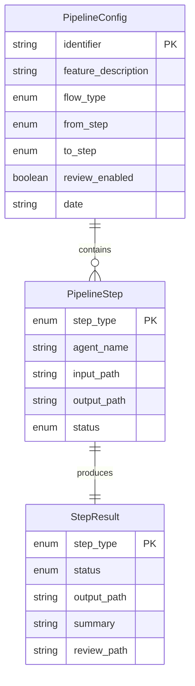
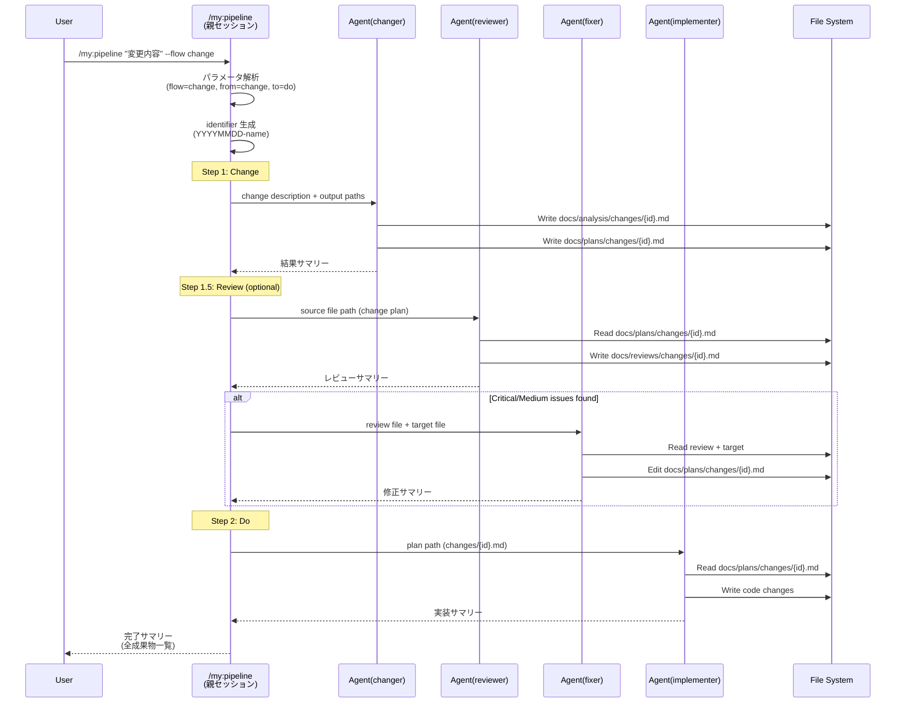
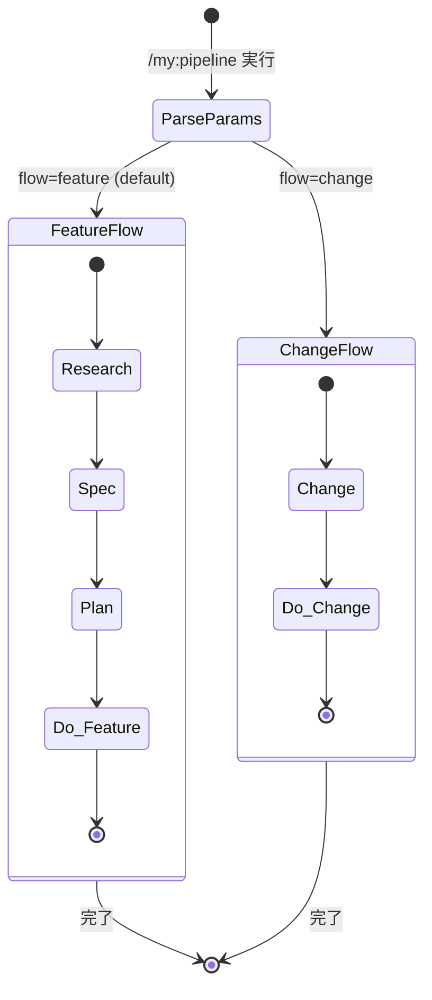

# Specification: Pipeline Change Flow Integration

## 1. Overview

`/my:pipeline` コマンドに `--flow change` オプションを追加し、既存の feature フロー（`research -> spec -> plan -> do`）に加えて change フロー（`change -> do`）をサポートする。これにより、難易度の低い変更タスクもパイプラインで一括実行できるようになる。

### 1.1 Purpose

現在、change フローは `/my:change` と `/my:do` を手動で逐次実行する必要がある。pipeline コマンドに統合することで、feature フローと同様にワンコマンドで `change -> do` を実行でき、レビューサイクルの自動適用やエラーハンドリングの恩恵を受けられるようにする。

### 1.2 Scope

| In Scope | Out of Scope |
|----------|--------------|
| `--flow change` オプションの追加 | `change -> plan -> do` フロー（plan ステップは change が自動生成するため不要） |
| change フローの step 定義（`change -> do`） | 既存の feature フローの変更 |
| `agents/changer.md` subagent の新規作成 | 既存の `/my:change`, `/my:do` コマンドの変更 |
| 事前検証ロジックの change フロー対応 | `--flow` 以外の新規フロータイプ（fix, refactor 等） |
| 完了時の成果物一覧に change 固有パスを含める | `~/.prompts/6_change.md`, `~/.prompts/7_do.md` の変更 |
| change plan に対するレビューサイクル | 複数回レビューサイクル |

### 1.3 References

- Research Document: `docs/research/20260407-pipeline-change-flow.md`
- Pipeline Orchestration Spec: `docs/specs/20260407-pipeline-orchestration.md`
- Pipeline Prompt: `~/.prompts/10_pipeline.md`
- Change Command Prompt: `~/.prompts/6_change.md`
- Do Command Prompt: `~/.prompts/7_do.md`

---

## 2. User Stories

### US-001: Change フローによるパイプライン実行
**As a** 開発者
**I want** `--flow change` を指定して change -> do をパイプラインで一括実行したい
**So that** 手動で `/my:change` と `/my:do` を逐次実行する手間を省ける

**Acceptance Criteria:**
- [ ] AC-001: `/my:pipeline "変更内容" --flow change` で change -> do が順次実行される
- [ ] AC-002: change ステップで `docs/analysis/changes/{id}.md` と `docs/plans/changes/{id}.md` が生成される
- [ ] AC-003: do ステップで `docs/plans/changes/{id}.md` を入力として実装が実行される

### US-002: Change フローの部分実行
**As a** 開発者
**I want** change フローの任意のステップ範囲で実行したい
**So that** change のみ実行して plan を確認してから do を実行できる

**Acceptance Criteria:**
- [ ] AC-001: `--flow change --to change` で change ステップのみ実行される
- [ ] AC-002: `--flow change --from do` で既存の change plan から do のみ実行される
- [ ] AC-003: `--from do` 指定時は `docs/plans/changes/{id}.md` の存在を事前検証する

### US-003: Change Plan のレビューサイクル
**As a** 開発者
**I want** change plan に対してもレビューサイクルを適用したい
**So that** 自動生成された change plan の品質を do 実行前に向上できる

**Acceptance Criteria:**
- [ ] AC-001: `--review` 指定時（デフォルト）、change ステップ後に reviewer -> fixer が実行される
- [ ] AC-002: レビュー対象は `docs/plans/changes/{id}.md`
- [ ] AC-003: レビュー結果は `docs/reviews/changes/{id}.md` に出力される
- [ ] AC-004: `--no-review` 指定時はレビューサイクルがスキップされる

### US-004: 後方互換性の維持
**As a** 開発者
**I want** `--flow` 未指定時は従来通り feature フローで動作してほしい
**So that** 既存のワークフローが壊れない

**Acceptance Criteria:**
- [ ] AC-001: `--flow` 未指定時はデフォルトで `feature` フローが使用される
- [ ] AC-002: 既存の feature フロー（`research -> spec -> plan -> do`）の動作に変更がない
- [ ] AC-003: 既存の `/my:change`, `/my:do` コマンドは変更なしで動作する

### US-005: Change フローの進捗表示と成果物一覧
**As a** 開発者
**I want** change フローでも feature フローと同様の進捗表示を見たい
**So that** 実行状況と成果物を把握できる

**Acceptance Criteria:**
- [ ] AC-001: 各ステップ開始時にステップ番号と全体ステップ数が表示される
- [ ] AC-002: パイプライン完了時に change 固有の成果物パス（`docs/analysis/changes/`, `docs/plans/changes/`）が表示される

### US-006: フロー間の無効な組み合わせのバリデーション
**As a** 開発者
**I want** `--flow change --from spec` のような無効な組み合わせでエラーを受け取りたい
**So that** 誤った操作を防止できる

**Acceptance Criteria:**
- [ ] AC-001: change フローで `--from` / `--to` に `research`, `spec`, `plan` を指定するとエラーになる
- [ ] AC-002: change フローで有効な `--from` / `--to` 値は `change` と `do` のみ
- [ ] AC-003: エラーメッセージに有効なステップ一覧が含まれる

---

## 3. API Interface

本機能は Claude Code のスラッシュコマンドの拡張として実装される。

### 3.1 コマンド拡張: `/my:pipeline`

**追加パラメータ:**

| Parameter | Type | Required | Default | Description |
|-----------|------|----------|---------|-------------|
| `--flow` | enum | No | `feature` | フロータイプ（`feature` / `change`） |

**Usage (change フロー):**
```
/my:pipeline <change_description_or_identifier> --flow change [options]
```

**有効なオプション組み合わせ (change フロー):**

| Options | Behavior |
|---------|----------|
| `--flow change` | change -> do (デフォルト: `--to do`) |
| `--flow change --to change` | change のみ実行 |
| `--flow change --from do` | do のみ実行（既存 plan 必須） |
| `--flow change --only change` | change のみ実行 |
| `--flow change --only do` | do のみ実行（既存 plan 必須） |

**実行例:**
```bash
# change -> do フルパイプライン（レビューあり）
/my:pipeline "ダークモードのボタンコントラスト改善" --flow change

# change のみ（plan を確認してから手動で do を実行）
/my:pipeline "ボタン改善" --flow change --to change

# 既存 change plan から do を実行
/my:pipeline 20260407-button-contrast --flow change --from do

# レビューなしの高速実行
/my:pipeline "ボタン改善" --flow change --no-review
```

**バリデーションルール (change フロー):**

```
change フローの step order: change < do

Validate:
- --flow change で --from/--to に change, do 以外を指定した場合:
  → Error: "Cannot use --from/--to with steps not in the change flow. Valid steps: change, do"
- --flow change で --from do かつ docs/plans/changes/{id}.md が存在しない場合:
  → Error: "Required input file not found: docs/plans/changes/{id}.md
     Run `/my:change {id}` first."
```

### 3.2 Subagent 呼び出しインターフェース (追加分)

#### changer subagent
```
subagent_type: changer
prompt:
  "Change description: '{change_description}'
   Identifier: {id}
   Output analysis: docs/analysis/changes/{id}.md
   Output plan: docs/plans/changes/{id}.md
   Today's date: {date}"
```

#### implementer subagent (change フロー)
```
subagent_type: implementer
prompt:
  "Feature name: {id}
   Plan document: docs/plans/changes/{id}.md"
```

#### reviewer subagent (change plan)
```
subagent_type: reviewer
prompt:
  "Review target: change_plan:{id}
   Source file: docs/plans/changes/{id}.md
   Output file: docs/reviews/changes/{id}.md"
```

#### fixer subagent (change plan)
```
subagent_type: fixer
prompt:
  "Review file: docs/reviews/changes/{id}.md
   Target file: docs/plans/changes/{id}.md
   Apply critical and medium priority feedback only."
```

---

## 4. Data Models

### 4.1 Entity: PipelineConfig (拡張)

既存の PipelineConfig に `flow_type` フィールドを追加する。

| Field | Type | Required | Description |
|-------|------|----------|-------------|
| identifier | string | Yes | `YYYYMMDD-{name}` 形式の一意識別子 |
| feature_description | string | Yes (新規時) | 機能/変更の説明文 |
| flow_type | FlowType | Yes | フロータイプ（デフォルト: `feature`） |
| from_step | StepType | Yes | 開始ステップ |
| to_step | StepType | Yes | 終了ステップ |
| review_enabled | boolean | Yes | レビューサイクルの有効/無効 |
| date | string | Yes | 実行日（`YYYY-MM-DD` 形式） |

### 4.2 Enum: FlowType (新規)

| Value | Description | Valid Steps |
|-------|-------------|-------------|
| `feature` | 機能開発フロー（デフォルト） | research, spec, plan, do |
| `change` | 変更フロー | change, do |

### 4.3 Entity: ChangeFlowStep (新規)

change フロー固有のステップ定義。

| Step | Subagent | Input | Output |
|------|----------|-------|--------|
| change | changer | change_description | `docs/analysis/changes/{id}.md` + `docs/plans/changes/{id}.md` |
| do | implementer | `docs/plans/changes/{id}.md` | (code changes) |

### 4.4 Enum: StepType (拡張)

既存の StepType に `change` を追加。

| Value | Description | Flow |
|-------|-------------|------|
| `research` | リサーチフェーズ | feature |
| `spec` | 仕様作成フェーズ | feature |
| `plan` | 実装計画フェーズ | feature |
| `do` | 実装フェーズ | feature, change |
| `change` | 変更分析・計画フェーズ | change |

### 4.5 Entity Relationships



---

## 5. System Flow

### 5.1 フロー選択 Sequence Diagram



### 5.2 フロー分岐の State Diagram



### 5.3 データフロー (change フロー)

```
Change Flow Data Flow:
  change  → docs/analysis/changes/YYYYMMDD-{id}.md
          → docs/plans/changes/YYYYMMDD-{id}.md
      ↓ (identifier を引き渡し)
  do      → 実際のコード変更

Optional Review cycle (change ステップ後):
  review  → docs/reviews/changes/{id}.md
  fix     → docs/plans/changes/{id}.md を Edit で更新
```

---

## 6. Edge Cases & Error Handling

| Scenario | Expected Behavior | Error Handling |
|----------|-------------------|----------------|
| `--flow change --from spec` (無効なステップ) | パラメータバリデーションエラー | `"Cannot use --from spec with --flow change. Valid steps: change, do"` |
| `--flow change --from do` で plan が存在しない | 事前検証エラー | `"Required input file not found: docs/plans/changes/{id}.md. Run /my:change {id} first."` |
| `--flow change --from plan` (plan は change フローに存在しない) | パラメータバリデーションエラー | `"Step 'plan' is not valid for change flow. Valid steps: change, do"` |
| `--flow invalid` (不正なフロータイプ) | パラメータバリデーションエラー | `"Invalid flow type: 'invalid'. Valid flows: feature, change"` |
| changer subagent がエラーで終了 | パイプラインを中断 | `"change failed. Resume with: /my:pipeline {id} --flow change --from change"` |
| `--flow change` で identifier が既存の feature plan と衝突 | change 固有パスを使うため衝突しない | `docs/plans/changes/{id}.md` と `docs/plans/features/{id}.md` はディレクトリが分離 |
| `--flow` 未指定で既存の change plan が存在する場合 | feature フローとして実行（change plan は無視） | デフォルトフローは feature のまま |
| changer の出力パスが `docs/analysis/changes/` のみで plan が未生成 | subagent 出力の事後検証でエラー | `"change step did not produce expected output: docs/plans/changes/{id}.md"` |

---

## 7. Security Considerations

### 7.1 Authentication

既存の pipeline 仕様と同じ。Claude Code CLI のローカル実行環境に依存。

### 7.2 Authorization

- changer subagent の tools は既存の change コマンドと同等のアクセス権限
- implementer subagent のアクセス権限は変更なし

### 7.3 Data Protection

- 全ての成果物はローカルファイルシステムに保存
- 既存の pipeline と同一のデータ保護方針に従う

---

## 8. Performance Requirements

| Metric | Target | Measurement Method |
|--------|--------|--------------------|
| change フロー全体（2ステップ、レビューなし） | < 5 min | 手動計測 |
| change フロー全体（2ステップ、レビューあり） | < 10 min | 手動計測 |
| change ステップ単体 | < 3 min | 手動計測 |
| 親セッションのコンテキスト消費 | subagent 結果サマリーのみ（各 < 500 tokens） | トークンカウント |

---

## 9. Testing Strategy

### 9.1 Unit Tests

- `--flow` パラメータの解析: `feature` (デフォルト), `change`, 不正値
- change フロー固有のバリデーション: `--from` / `--to` に無効なステップを指定した場合のエラー
- change フローの step order 計算: `change < do`
- 事前検証ロジック: `--flow change --from do` 時の `docs/plans/changes/{id}.md` 存在チェック

### 9.2 Integration Tests

- changer subagent の起動と正常完了確認（`~/.prompts/6_change.md` の読み込み、2ファイル出力）
- change -> do のステップ間ファイル引き渡し確認
- change plan に対するレビューサイクル動作確認（reviewer -> fixer -> plan 更新）
- implementer が `docs/plans/changes/{id}.md` を正しく change タイプとして認識すること

### 9.3 E2E Tests

- change フローのフルパイプライン実行（change -> do、レビューあり）
- change フローの部分実行（`--to change` で change のみ、`--from do` で do のみ）
- feature フローとの混在テスト（同一 identifier で両フローを実行した場合の独立性確認）
- エラーリカバリ（change ステップ失敗後の `--from change` による再開）

---

## 10. Open Items

- [ ] Q1: `--flow` オプション名の最終決定。`--flow`, `--mode`, `--type` のいずれか。research では `--flow` を推奨。
- [ ] Q2: `change -> plan -> do` フローの将来的なサポート。現時点では対象外とし、`--review` による自動改善で代替する。
- [ ] Q3: changer subagent の `description` フィールドの記述内容（Agent tool routing に影響）。
- [ ] Q4: 将来的に `--flow fix` や `--flow refactor` を追加する場合のフレームワーク設計。

---

## 11. Implementation Notes

### 11.1 変更が必要なファイル

| File | Change Type | Description |
|------|-------------|-------------|
| `~/.prompts/10_pipeline.md` | 修正 | `--flow` オプション追加、change フロー step 定義、事前検証拡張 |
| `commands/my/pipeline.md` | 修正 | `--flow` パラメータのドキュメント・Examples 追加 |
| `agents/changer.md` | 新規作成 | change subagent 定義 |

### 11.2 変更不要なファイル

| File | Reason |
|------|--------|
| `~/.prompts/6_change.md` | changer subagent が Read するだけ |
| `~/.prompts/7_do.md` | change plan の resolution が既に実装済み |
| `agents/implementer.md` | `plans/changes/{id}.md` は既にサポート済み |
| `commands/my/change.md` | pipeline 外の単発実行はそのまま維持 |
| `commands/my/do.md` | 変更不要 |

### 11.3 `agents/changer.md` の構成案

```markdown
---
name: changer
description: "Analyzes change requests and generates change plans"
tools: ["Read", "Write", "Edit", "Glob", "Grep", "Bash"]
---

Read the prompt file at `~/.prompts/6_change.md` and follow it exactly.
```

### 11.4 `10_pipeline.md` への追記内容概要

1. Parameter Parsing セクション: `--flow <feature|change>` オプションの追加
2. Validation Rules セクション: フロー別の有効ステップバリデーション
3. Input File Pre-validation セクション: change フロー用の検証ルール追加
4. Pipeline Definition セクション: change フローの step 定義追加
5. Subagent Prompts セクション: changer subagent のプロンプトテンプレート追加
6. Execution Flow セクション: 完了時の成果物一覧に change 固有パスを追加
7. Error Handling セクション: change フロー固有のエラーメッセージ追加

---
**Created:** 2026-04-07
**Last Updated:** 2026-04-07
**Status:** Draft
**Author:** Claude Code
