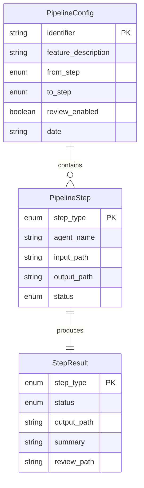
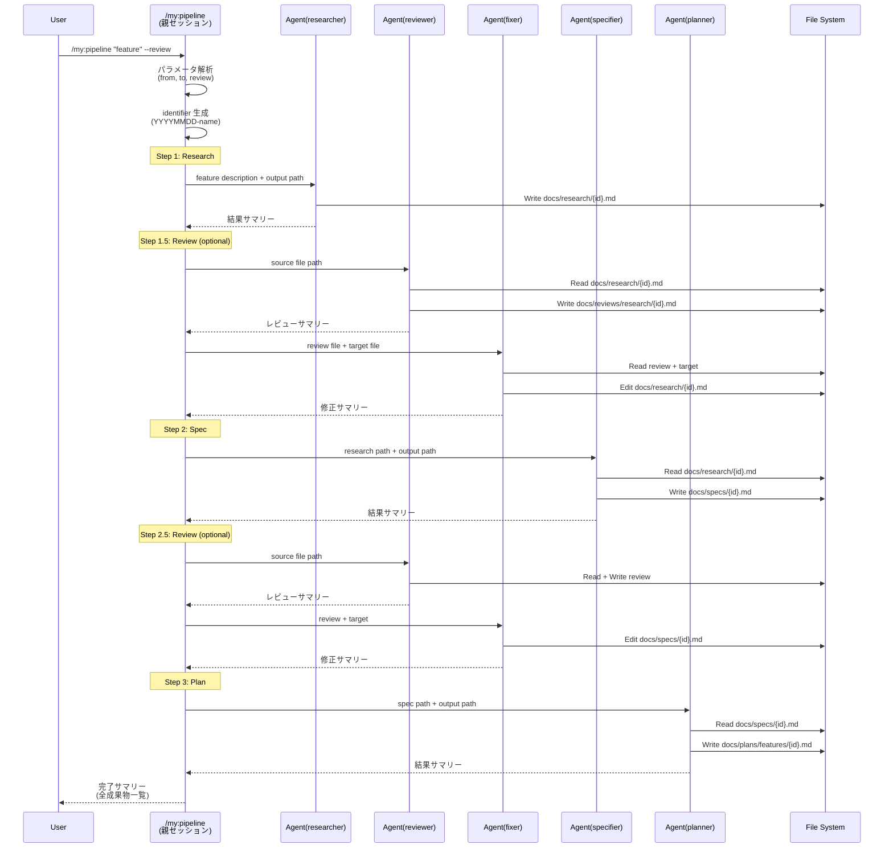
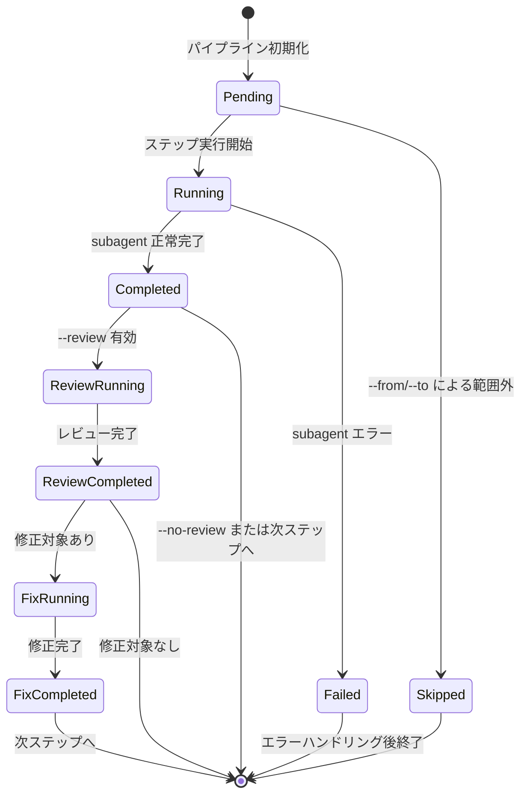

# Specification: Pipeline Orchestration for Sequential Command Execution

## 1. Overview

`/my:*` コマンド群（research, spec, plan, do, review）を subagent ベースで逐次実行し、各ステップの出力を次のステップに自動引き渡しするパイプラインオーケストレーション機能の仕様。

### 1.1 Purpose

現在の `/my:*` コマンド群は個別に手動実行する必要があり、ファイル名の手動コピー、コンテキスト汚染、レビューサイクルの手間、再開困難といった課題がある。本機能は `/my:pipeline` コマンドによるワンコマンド実行でこれらを解決し、research → spec → plan → do の一連のフローを自動化する。

### 1.2 Scope

| In Scope | Out of Scope |
|----------|--------------|
| `/my:pipeline` コマンドの定義 | 外部 CI/CD との連携 |
| subagent による各ステップの逐次実行 | Agent SDK (Python/TypeScript) による制御 |
| ステップ間のファイル名自動引き渡し | 並列ステップ実行 |
| `--from` / `--to` による部分実行 | GUI / Web UI |
| `--review` / `--no-review` によるレビュー統合 | subagent 定義ファイルの新規作成（実装済み） |
| レビュー結果に基づく自動修正（1サイクル） | 複数回レビューサイクル |
| 進捗表示 | |

### 1.3 References

- Research Document: `docs/research/20260407-pipeline-orchestration.md`
- Subagent 定義: `agents/` ディレクトリ（researcher, specifier, planner, implementer, reviewer, fixer）
- 既存プロンプト: `~/.prompts/1_research.md`, `~/.prompts/2_spec.md`, `~/.prompts/3_plan.md`, `~/.prompts/7_do.md`, `~/.prompts/8_review.md`

---

## 2. User Stories

### US-001: フルパイプライン実行
**As a** 開発者
**I want** feature 名を指定して research → spec → plan までを一発で実行したい
**So that** 手動でのファイル名コピーやコマンド逐次実行の手間を省ける

**Acceptance Criteria:**
- [ ] AC-001: `/my:pipeline "機能名"` で research → spec → plan が順次実行される
- [ ] AC-002: 各ステップの成果物が規定のディレクトリ（`docs/research/`, `docs/specs/`, `docs/plans/features/`）に出力される
- [ ] AC-003: 前ステップの出力ファイルパスが自動的に次ステップの入力として渡される

### US-002: 部分実行（任意のステップ範囲）
**As a** 開発者
**I want** パイプラインの任意のステップから開始し、任意のステップで終了したい
**So that** 途中で中断した場合の再開や、特定ステップだけのやり直しができる

**Acceptance Criteria:**
- [ ] AC-001: `--from spec --to plan` で spec と plan のみ実行される
- [ ] AC-002: `--only research` で research のみ実行される
- [ ] AC-003: `--from` 指定時は既存の identifier を受け取り、対応する入力ファイルの存在を事前検証する

### US-003: レビュー統合パイプライン
**As a** 開発者
**I want** 各ステップ後にレビュー＆修正サイクルを自動実行するか選択したい
**So that** パイプラインの品質とスピードのトレードオフを制御できる

**Acceptance Criteria:**
- [ ] AC-001: `--review` 指定時、各ステップ後に reviewer subagent → fixer subagent が実行される
- [ ] AC-002: `--no-review` 指定時、レビューサイクルがスキップされる
- [ ] AC-003: デフォルトはレビューあり（`--review`）
- [ ] AC-004: レビュー結果は `docs/reviews/{type}/{id}.md` に出力される
- [ ] AC-005: 修正は Critical/Medium priority の指摘のみ対象とする

### US-004: クリーンなコンテキストでのステップ実行
**As a** 開発者
**I want** 各ステップが独立したコンテキストで実行されてほしい
**So that** 前ステップのコンテキスト汚染によるトークン消費増大や品質低下を防げる

**Acceptance Criteria:**
- [ ] AC-001: 各ステップは Agent ツール経由で subagent として実行される
- [ ] AC-002: subagent は独立したコンテキストウィンドウで実行される
- [ ] AC-003: subagent からの返却は要約のみで、親セッションのコンテキスト消費を最小化する

### US-005: 進捗表示
**As a** 開発者
**I want** パイプライン全体の進捗状況を把握したい
**So that** どのステップまで完了したか、次に何が実行されるかがわかる

**Acceptance Criteria:**
- [ ] AC-001: 各ステップ開始時にステップ番号と全体ステップ数が表示される（例: `[2/6] Running: spec`）
- [ ] AC-002: 各ステップ完了時に成果物ファイルパスが表示される
- [ ] AC-003: パイプライン完了時に全成果物の一覧が表示される

### US-006: 既存コマンドとの互換性
**As a** 開発者
**I want** 既存の `/my:*` コマンドがそのまま単発で使えてほしい
**So that** パイプライン導入後も従来のワークフローが壊れない

**Acceptance Criteria:**
- [ ] AC-001: 既存の `/my:research`, `/my:spec`, `/my:plan`, `/my:review` コマンドは変更なしで動作する
- [ ] AC-002: `/my:pipeline --only research` は `/my:research` と同等の成果物を出力する

---

## 3. API Interface

本機能は Claude Code のスラッシュコマンドとして実装されるため、REST API ではなくコマンドインターフェースとして定義する。

### 3.1 コマンド: `/my:pipeline`

**Description:** パイプラインオーケストレーションの起動コマンド

**Usage:**
```
/my:pipeline <feature_description_or_identifier> [options]
```

**Parameters:**

| Parameter | Type | Required | Default | Description |
|-----------|------|----------|---------|-------------|
| `feature_description_or_identifier` | string | Yes | - | 機能の説明文（新規の場合）または既存の identifier（`YYYYMMDD-name` 形式） |
| `--from` | enum | No | `research` | 開始ステップ（`research` / `spec` / `plan` / `do`） |
| `--to` | enum | No | `plan` | 終了ステップ（`research` / `spec` / `plan` / `do`） |
| `--only` | enum | No | - | 単一ステップのみ実行（`--from`/`--to` と排他） |
| `--review` | flag | No | `true` | レビューサイクルを有効化 |
| `--no-review` | flag | No | - | レビューサイクルを無効化 |

**実行例:**
```bash
# フルパイプライン（research → plan、レビューあり）
/my:pipeline "issue #444 の解決"

# レビューなしの高速実行
/my:pipeline "新機能追加" --from research --to do --no-review

# 既存 research から spec → plan のみ
/my:pipeline 20260407-feature-name --from spec --to plan

# 単一ステップ
/my:pipeline 20260407-feature-name --only research
```

### 3.2 Subagent 呼び出しインターフェース

各 subagent は Agent ツール経由で以下の形式で起動される。

#### researcher subagent
```
Feature description: '{feature_description}'
Output file: docs/research/YYYYMMDD-{id}.md
Today's date: YYYY-MM-DD
```

#### reviewer subagent
```
Review target: {type}:{identifier}
Source file: docs/{type_path}/{identifier}.md
Output file: docs/reviews/{type}/{identifier}.md
```

#### fixer subagent
```
Review file: docs/reviews/{type}/{identifier}.md
Target file: docs/{type_path}/{identifier}.md
Apply critical and medium priority feedback only.
```

#### specifier subagent
```
Feature name: {identifier}
Research document: docs/research/{identifier}.md
Output file: docs/specs/{identifier}.md
```

#### planner subagent
```
Feature name: {identifier}
Spec document: docs/specs/{identifier}.md
Output file: docs/plans/features/{identifier}.md
```

#### implementer subagent
```
Feature name: {identifier}
Plan document: docs/plans/features/{identifier}.md
```

---

## 4. Data Models

### 4.1 Entity: PipelineConfig

パイプライン実行時の構成を表す論理モデル。

| Field | Type | Required | Description |
|-------|------|----------|-------------|
| identifier | string | Yes | `YYYYMMDD-{name}` 形式の一意識別子 |
| feature_description | string | Yes (新規時) | 機能の説明文 |
| from_step | StepType | Yes | 開始ステップ |
| to_step | StepType | Yes | 終了ステップ |
| review_enabled | boolean | Yes | レビューサイクルの有効/無効 |
| date | string | Yes | 実行日（`YYYY-MM-DD` 形式） |

### 4.2 Entity: PipelineStep

パイプライン内の各ステップを表す。

| Field | Type | Required | Description |
|-------|------|----------|-------------|
| step_type | StepType | Yes | ステップ種別 |
| agent_name | string | Yes | 使用する subagent 名 |
| input_path | string | No | 入力ファイルパス（research は不要） |
| output_path | string | Yes | 出力ファイルパス |
| status | StepStatus | Yes | 実行状態 |

### 4.3 Entity: StepResult

各ステップの実行結果を表す。

| Field | Type | Required | Description |
|-------|------|----------|-------------|
| step_type | StepType | Yes | ステップ種別 |
| status | StepStatus | Yes | 完了状態 |
| output_path | string | Yes | 出力ファイルパス |
| summary | string | Yes | subagent からの返却サマリー |
| review_path | string | No | レビュー結果ファイルパス（レビューありの場合） |

### 4.4 Enum: StepType

| Value | Description |
|-------|-------------|
| `research` | リサーチフェーズ |
| `spec` | 仕様作成フェーズ |
| `plan` | 実装計画フェーズ |
| `do` | 実装フェーズ |

### 4.5 Enum: StepStatus

| Value | Description |
|-------|-------------|
| `pending` | 未実行 |
| `running` | 実行中 |
| `completed` | 完了 |
| `failed` | 失敗 |
| `skipped` | スキップ |

### 4.6 Entity Relationships



---

## 5. System Flow

### 5.1 メインパイプライン実行フロー（Sequence Diagram）



### 5.2 State Diagram: パイプラインステップの状態遷移



### 5.3 データフロー

```
Pipeline Data Flow:
  research  → docs/research/YYYYMMDD-{id}.md
      ↓ (identifier を引き渡し)
  spec      → docs/specs/YYYYMMDD-{id}.md
      ↓ (identifier を引き渡し)
  plan      → docs/plans/features/YYYYMMDD-{id}.md
      ↓ (identifier を引き渡し)
  do        → 実際のコード変更

Optional Review cycle (各ステップ後):
  review    → docs/reviews/{type}/{id}.md
  fix       → 元のドキュメントを Edit で更新
```

---

## 6. Edge Cases & Error Handling

| Scenario | Expected Behavior | Error Handling |
|----------|-------------------|----------------|
| `--from spec` 指定時に research ファイルが存在しない | パイプライン開始前にエラー表示 | 入力ファイル存在チェックを事前実行し、不足時はエラーメッセージで必要なファイルパスを提示 |
| subagent がエラーで終了 | パイプラインを中断し、完了済みステップの成果物は保持 | エラーメッセージと `--from` オプションによる再開方法を表示 |
| 既存の identifier と同名ファイルが存在 | 上書きする（既存コマンドと同じ挙動） | 実行前に上書き対象のファイルパスを表示 |
| `--from` が `--to` より後のステップ | パラメータバリデーションエラー | `--from` は `--to` 以前のステップである必要がある旨のエラーメッセージ |
| `--only` と `--from`/`--to` の同時指定 | パラメータバリデーションエラー | 排他オプションである旨のエラーメッセージ |
| `.prompts/*.md` ファイルが存在しない | subagent 起動前に存在チェック | 不足ファイルのパスを一覧表示し中断 |
| subagent 定義ファイル（`~/.claude/agents/*.md`）が存在しない | パイプライン開始前にエラー表示 | セットアップ手順（シンボリックリンクコマンド）を表示 |
| reviewer が指摘なし（修正不要）の場合 | fixer ステップをスキップし次ステップへ進む | レビュー結果に "no issues" を示すサマリーを記録 |
| feature_description からの identifier 生成で不正文字 | 英数字とハイフンのみに正規化 | 日本語はローマ字化せず、英語キーワードを抽出して identifier とする |

---

## 7. Security Considerations

### 7.1 Authentication

本機能は Claude Code CLI のローカル実行環境で動作するため、外部認証は不要。Claude Code 自体の認証（API キー）に依存する。

### 7.2 Authorization

- 各 subagent の `tools` フィールドでツールアクセスを制限（例: reviewer は Write 不要、fixer は WebSearch 不要）
- `mcpServers` フィールドで不要な MCP サーバーへのアクセスをスコープ化

### 7.3 Data Protection

- 全ての中間成果物はローカルファイルシステムに保存（外部送信なし）
- `.env` や credentials を含むファイルは subagent の Read 対象外として指示
- パイプライン実行ログに機密情報を含めない

---

## 8. Performance Requirements

| Metric | Target | Measurement Method |
|--------|--------|--------------------|
| パイプライン全体（3ステップ、レビューなし） | < 10 min | 手動計測 |
| パイプライン全体（3ステップ、レビューあり） | < 20 min | 手動計測 |
| 単一ステップ実行 | 既存コマンドと同等（< 5 min） | 手動計測 |
| 親セッションのコンテキスト消費 | subagent 結果サマリーのみ（各 < 500 tokens） | トークンカウント |

---

## 9. Testing Strategy

### 9.1 Unit Tests

- パラメータ解析ロジック: `--from`, `--to`, `--only`, `--review` の組み合わせバリデーション
- identifier 生成ロジック: feature_description からの正規化
- ステップ順序ロジック: from/to のステップ範囲計算

### 9.2 Integration Tests

- 各 subagent の起動と正常完了確認（subagent 定義ファイルの読み込み、`.prompts/*.md` の Read）
- ステップ間のファイル引き渡し確認（research の出力が spec の入力として渡される）
- レビューサイクルの動作確認（reviewer → fixer → 元ファイル更新）

### 9.3 E2E Tests

- フルパイプライン（research → plan、レビューあり）の実行と全成果物の検証
- 部分実行（`--from spec --to plan`）で既存 research からの spec/plan 生成
- エラーリカバリ（途中失敗後の `--from` による再開）

---

## 10. Open Items

- [ ] レビュー→修正サイクルの最大回数（推奨: 1回、将来的に設定可能にするか）
- [ ] `do` ステップをデフォルトパイプラインに含めるか（コード変更は確認後の方が安全）
- [ ] 各 subagent に `model` を個別指定すべきか（例: reviewer は sonnet、researcher は opus）
- [ ] `/my:pipeline` 実行前にユーザー確認（パイプライン内容のプレビュー）を挟むべきか
- [ ] identifier の自動生成ロジックの詳細（日本語 feature_description からの英語 identifier 抽出方法）

---

## 11. Implementation Notes

### 11.1 成果物構成

```
commands/my/
  pipeline.md                    # /my:pipeline コマンド定義（新規作成）

prompts/
  10_pipeline.md                 # pipeline オーケストレーションロジック（新規作成）

agents/                          # 実装済み（~/.claude/agents/ にシンボリックリンク）
  researcher.md
  specifier.md
  planner.md
  implementer.md
  reviewer.md
  fixer.md
```

### 11.2 実装フェーズ

| Phase | 内容 | 依存 |
|-------|------|------|
| Phase 1 | subagent 定義ファイル | **実装済み** |
| Phase 2 | `/my:pipeline` コマンド（基本パイプライン: research → spec → plan） | Phase 1 |
| Phase 3 | レビュー統合（各ステップ後の reviewer + fixer サイクル） | Phase 2 |
| Phase 4 | 高度なオプション（`--model`, `--by-gemini`, `do` ステップ統合等） | Phase 3 |

---
**Created:** 2026-04-07
**Last Updated:** 2026-04-07
**Status:** Draft
**Author:** Claude Code
