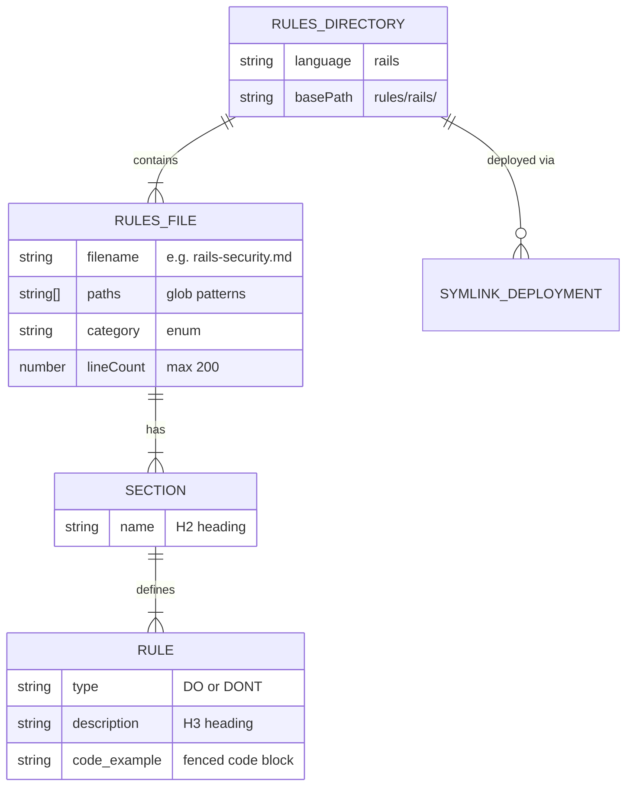
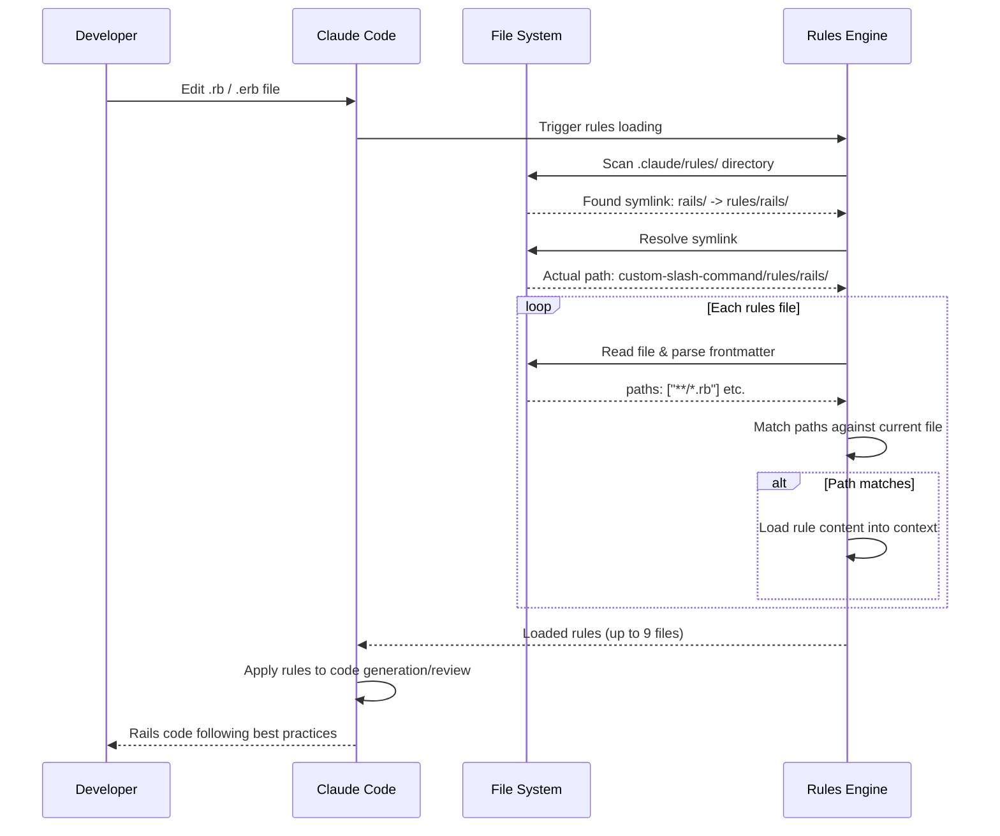
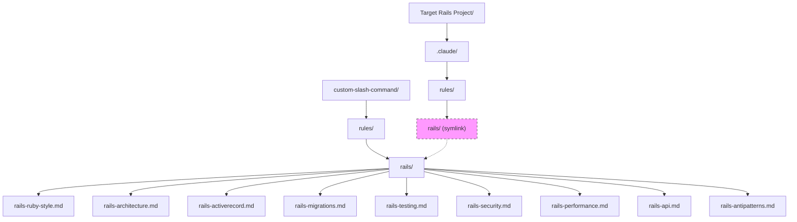
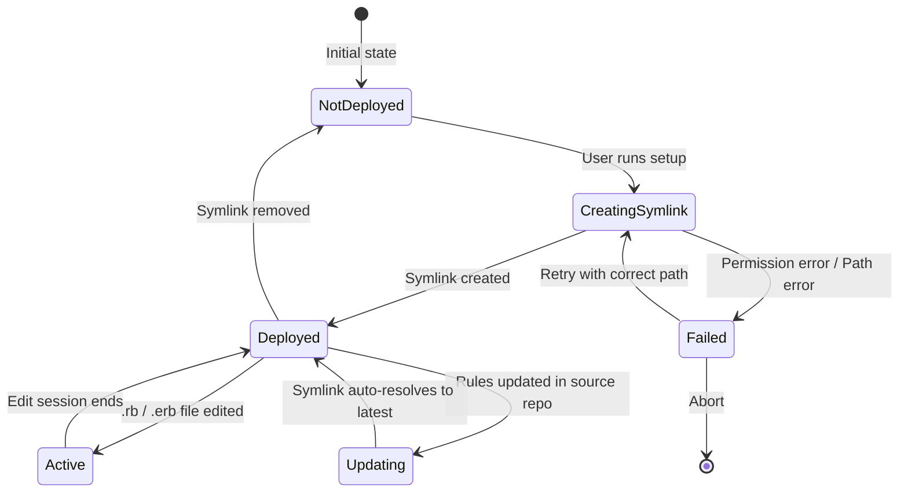

# Specification: Ruby on Rails Coding Rules for Claude Code

## 1. Overview

### 1.1 Purpose

Ruby on Rails のコーディングベストプラクティスを Claude Code の rules として体系化し、`.rb` / `.erb` ファイル編集時に自動ロードされる仕組みを構築する。Rails の Convention over Configuration の哲学に沿い、Ruby Style Guide / Rails Style Guide / OWASP / Rails Guides をベースに、具体的かつアクション可能なルール群を提供する。Rails 7.1+ / Rails 8 および Ruby 3.2+ を前提とする。

### 1.2 Scope

| In Scope | Out of Scope |
|----------|--------------|
| Ruby スタイル・命名規約の rules 作成 | RuboCop `.rubocop.yml` 設定テンプレート |
| Rails MVC・アーキテクチャパターンの rules 作成 | Slim / Haml テンプレートエンジン規約 |
| ActiveRecord・クエリ最適化の rules 作成 | Rails 以外の Ruby フレームワーク（Sinatra 等） |
| マイグレーション・スキーマ規約の rules 作成 | デプロイ・インフラ構成 |
| テスト規約（RSpec / Minitest 両対応）の rules 作成 | Hotwire（Turbo / Stimulus）固有ルール（P2 として将来検討） |
| セキュリティベストプラクティスの rules 作成 | プロジェクト固有のカスタムルール |
| パフォーマンス・キャッシュパターンの rules 作成 | CI/CD パイプライン設定 |
| API 設計パターンの rules 作成 | |
| アンチパターン集の rules 作成 | |
| `paths` フロントマターによるスコープ制御 | |
| 各ファイル 200 行以下の制約遵守 | |

### 1.3 References

- Research Document: `docs/research/20260407-rails-rules.md`
- Go Rules (format reference): `rules/go/`, `docs/specs/20260406-go-coding-rules.md`
- TS/React Rules (format reference): `rules/typescript/`, `docs/specs/20260406-ts-react-rules.md`
- [Ruby Style Guide](https://github.com/rubocop/ruby-style-guide)
- [Rails Style Guide](https://github.com/rubocop/rails-style-guide)
- [Rails Guides](https://guides.rubyonrails.org/)
- [OWASP Ruby on Rails Cheat Sheet](https://cheatsheetseries.owasp.org/cheatsheets/Ruby_on_Rails_Cheat_Sheet.html)
- [Rails 8.0 Release Notes](https://guides.rubyonrails.org/8_0_release_notes.html)

---

## 2. User Stories

### US-001: Rails コード生成時のベストプラクティス自動適用

**As a** Rails 開発者（Claude Code ユーザー）
**I want** `.rb` / `.erb` ファイルを編集する際に Rails のベストプラクティスが自動的に参照されたい
**So that** 慣用的で高品質な Rails コードを一貫して生成できる

**Acceptance Criteria:**
- [ ] AC-001: `rules/rails/` ディレクトリに 9 つのカテゴリ別 rules ファイルが存在する
- [ ] AC-002: 各ファイルに適切な `paths` フロントマターが設定されている
- [ ] AC-003: `.rb` / `.erb` ファイル編集時にルールが自動ロードされる
- [ ] AC-004: 各ファイルが 200 行以下である

### US-002: シンボリックリンクによる他プロジェクトへの配備

**As a** チームリード
**I want** rules を一元管理し、各 Rails プロジェクトにシンボリックリンクで配備したい
**So that** プロジェクト横断で一貫した Rails コーディング品質を適用できる

**Acceptance Criteria:**
- [ ] AC-001: `rules/rails/` ディレクトリ単位でシンボリックリンク可能な構造になっている
- [ ] AC-002: シンボリックリンク経由で Claude Code がルールを正しくロードできる
- [ ] AC-003: 配備手順がドキュメント化されている

### US-003: カテゴリ別のルール管理

**As a** 開発者
**I want** ルールがカテゴリごとに分割されていてほしい
**So that** 特定のトピック（セキュリティ、ActiveRecord 等）のルールを個別に参照・更新できる

**Acceptance Criteria:**
- [ ] AC-001: 各カテゴリが独立したファイルとして管理されている
- [ ] AC-002: ファイル名からカテゴリが識別可能（`rails-security.md` 等）
- [ ] AC-003: カテゴリ間に不要な依存関係がない

### US-004: レビュー時の Rails 固有問題の自動検出

**As a** レビュアー
**I want** レビュー時に Rails 固有の問題（N+1、セキュリティ脆弱性等）が自動的に検出・指摘されてほしい
**So that** レビュー品質が向上し、Rails 特有の落とし穴を見落とさない

**Acceptance Criteria:**
- [ ] AC-001: ルールが DO / DON'T の両方をコード例付きで含む
- [ ] AC-002: N+1 問題、SQL インジェクション等のアンチパターンが具体例とともに記載されている
- [ ] AC-003: 各ルールに修正方法・推奨パターンが含まれている

### US-005: Rails 8 最新機能への対応

**As a** Rails 8 を使用する開発者
**I want** Solid Queue / Solid Cache / 認証ジェネレータ等の最新ベストプラクティスが反映されていてほしい
**So that** 最新の Rails エコシステムに沿ったコードを書ける

**Acceptance Criteria:**
- [ ] AC-001: `params.expect` が Strong Parameters の推奨パターンとして記載されている
- [ ] AC-002: Solid Queue / Solid Cache の使用パターンがパフォーマンスルールに含まれている
- [ ] AC-003: Rails 8 認証ジェネレータが認証の推奨パターンとして記載されている

---

## 3. Rules File Interface

### 3.1 File Format

各 rules ファイルは以下の形式に従う（Go / TS / React ルールと同一フォーマット）:

```markdown
---
paths:
  - "**/*.rb"
---

# {Category Title}

## {Section}

### DO: {Good Practice}
- Description of the practice
- Code example (if applicable)

### DON'T: {Anti-pattern}
- Description of what to avoid
- Why it's problematic
```

### 3.2 YAML Frontmatter Schema

各ファイルの `paths` 設定:

| File | paths |
|------|-------|
| `rails-ruby-style.md` | `["**/*.rb"]` |
| `rails-architecture.md` | `["**/*.rb"]` |
| `rails-activerecord.md` | `["**/*.rb"]` |
| `rails-migrations.md` | `["db/migrate/**/*.rb", "**/*.rb"]` |
| `rails-testing.md` | `["spec/**/*.rb", "test/**/*.rb", "**/*.rb"]` |
| `rails-security.md` | `["**/*.rb", "**/*.erb"]` |
| `rails-performance.md` | `["**/*.rb", "**/*.erb"]` |
| `rails-api.md` | `["app/controllers/api/**/*.rb", "**/*.rb"]` |
| `rails-antipatterns.md` | `["**/*.rb"]` |

### 3.3 File Inventory

| File | Description | Priority | Lines (est.) |
|------|-------------|----------|-------------|
| `rails-ruby-style.md` | Ruby スタイル・命名規約 | P1 | ~150 |
| `rails-architecture.md` | MVC・アーキテクチャパターン | P0 | ~180 |
| `rails-activerecord.md` | ActiveRecord・クエリ最適化 | P0 | ~180 |
| `rails-migrations.md` | マイグレーション・スキーマ | P2 | ~140 |
| `rails-testing.md` | テスト規約（RSpec / Minitest） | P1 | ~180 |
| `rails-security.md` | セキュリティベストプラクティス | P0 | ~180 |
| `rails-performance.md` | パフォーマンス・キャッシュ | P2 | ~170 |
| `rails-api.md` | API 設計パターン | P2 | ~150 |
| `rails-antipatterns.md` | アンチパターン集 | P1 | ~160 |

---

## 4. Data Models

### 4.1 Entity: RulesFile

| Field | Type | Required | Description |
|-------|------|----------|-------------|
| filename | string | Yes | ファイル名（`rails-{category}.md`） |
| category | enum | Yes | ruby-style \| architecture \| activerecord \| migrations \| testing \| security \| performance \| api \| antipatterns |
| paths | string[] | Yes | 適用対象のファイルパターン |
| content | string | Yes | ルール本文（Markdown） |
| lineCount | number | Yes | 行数（200 以下） |

### 4.2 Entity: RulesDirectory

| Field | Type | Required | Description |
|-------|------|----------|-------------|
| language | string | Yes | フレームワーク名（`rails`） |
| basePath | string | Yes | `rules/rails/` |
| files | RulesFile[] | Yes | 配下の rules ファイル群（9 ファイル） |

### 4.3 Entity: SymlinkDeployment

| Field | Type | Required | Description |
|-------|------|----------|-------------|
| source | string | Yes | `{repo}/rules/rails/` |
| target | string | Yes | `{project}/.claude/rules/rails` |
| type | string | Yes | directory symlink |

### 4.4 Entity Relationships



---

## 5. System Flow

### 5.1 Sequence Diagram - Rules Loading Flow



### 5.2 Directory Structure Diagram



### 5.3 State Diagram - Symlink Deployment



---

## 6. Rules Categories Specification

### 6.1 rails-security.md (P0)

**Purpose:** Rails 固有のセキュリティベストプラクティス。OWASP / Brakeman 準拠。

**paths:** `["**/*.rb", "**/*.erb"]`

**Key Topics:**
- Strong Parameters: `params.expect`（Rails 8）を優先、`params.require.permit` も記載
- CSRF 対策: `protect_from_forgery` の有効化
- XSS 防止: ERB 自動エスケープの信頼、`raw` / `html_safe` の制限
- SQL インジェクション防止: プレースホルダー必須、文字列補間禁止
- 認証: Rails 8 認証ジェネレータ推奨、Devise は高度な要件向け
- 認可: Pundit / CanCanCan
- Brakeman: CI への組み込み推奨
- bundler-audit: 依存 gem のセキュリティ監査
- rack-attack: レートリミティング
- 暗号化: `Rails.application.credentials` で秘密情報管理
- セッション管理: cookie store（デフォルト）の署名・暗号化、ActiveRecord セッションストアの検討
- HTTPS: `config.force_ssl = true`

**Code Example:**
```ruby
# DO: SQL injection prevention with placeholder
User.where("email = ?", params[:email])
User.where(email: params[:email])

# DON'T: String interpolation in SQL
User.where("email = '#{params[:email]}'")
```

### 6.2 rails-activerecord.md (P0)

**Purpose:** ActiveRecord クエリ最適化、N+1 対策、効率的なデータアクセスパターン

**paths:** `["**/*.rb"]`

**Key Topics:**
- N+1 対策: `includes` / `preload` / `eager_load` の使い分け
- `strict_loading`: lazy loading の防止（Rails 7+）
- Bullet gem: 開発環境での N+1 検出
- `find_each` / `find_in_batches`: バッチ処理
- `pluck`: 必要カラムのみ取得（メモリ効率）
- `exists?` / `any?`: `count > 0` より効率的
- トランザクション: 複数 DB 操作の原子性保証
- Raw SQL の回避: ActiveRecord クエリインターフェース優先
- インデックス: 外部キー、WHERE / ORDER BY 対象カラム

**Code Example:**
```ruby
# DO: includes for N+1 prevention
posts = Post.includes(:author, :tags).limit(20)
posts.each { |p| puts p.author.name }

# DON'T: Lazy loading causing N+1
posts = Post.limit(20)
posts.each { |p| puts p.author.name }

# DO: pluck for memory efficiency
user_ids = User.active.pluck(:id)

# DON'T: Loading all columns then mapping
user_ids = User.active.map(&:id)
```

### 6.3 rails-architecture.md (P0)

**Purpose:** Rails MVC パターン、Concerns、Strong Parameters、コールバック規約

**paths:** `["**/*.rb"]`

**Key Topics:**
- Skinny Controller, Fat Model: Controller はリクエスト処理に専念
- Concerns: 複数クラス間の共有機能のみ。単一クラスの複雑さ隠蔽に使わない
- Service Objects: `-er` 命名を避け、ドメインモデルとしての抽象化を検討
- Strong Parameters: Controller で必須。Rails 8 では `params.expect` 推奨
- Callbacks: `before_action` / `after_action` は最小限
- ActiveRecord スコープ: 再利用可能なクエリは `scope` 定義
- Validation: Model に記述、Custom validator は `app/validators/` に配置
- Enum: マジックナンバー排除
- Rails 8 認証ジェネレータの活用

**Code Example:**
```ruby
# DO (Rails 8): params.expect for type-safe parameters
def user_params
  params.expect(user: [:name, :email, { roles: [] }])
end

# ACCEPTABLE (Rails 7.x): require + permit is the standard pattern in Rails 7.x
# PREFER params.expect in Rails 8+ for improved type safety
def user_params
  params.require(:user).permit(:name, :email, roles: [])
end
```

### 6.4 rails-ruby-style.md (P1)

**Purpose:** Ruby 言語のコーディングスタイル・命名規約。Community Style Guide 準拠。

**paths:** `["**/*.rb"]`

**Key Topics:**
- インデント: 2 spaces（タブ禁止）
- 命名: `snake_case`（メソッド・変数）、`PascalCase`（クラス・モジュール）、`SCREAMING_SNAKE_CASE`（定数）
- メソッド長: 10 行以下目安
- クラス長: 100 行以下目安
- 未使用変数: `_` prefix
- accessor: `get_` / `set_` prefix 禁止、`attr_name` / `attr_name=` 使用
- frozen string literal: `# frozen_string_literal: true`
- ドキュメント: YARD 形式
- 論理演算子: `&&` / `||` を条件式に使用（`and` / `or` は制御フロー限定）
- Pattern matching（Ruby 3.x）の活用推奨
- RuboCop / rubocop-rails との整合性

### 6.5 rails-testing.md (P1)

**Purpose:** テストのベストプラクティス。RSpec / Minitest 両対応。

**paths:** `["spec/**/*.rb", "test/**/*.rb", "**/*.rb"]`

**Key Topics:**
- テストピラミッド: Unit (多) > Integration (中) > System (少)
- RSpec 規約:
  - `describe` でクラス/メソッド、`context` で条件分岐
  - `let` / `let!` の使い分け
  - `subject` で対象を明示
  - `shared_examples` / `shared_context` で DRY
  - `before` は最小限のセットアップ
- Minitest 規約:
  - `test_` prefix
  - assert 系メソッド活用
  - fixtures でテストデータ管理
- FactoryBot: `create` より `build` / `build_stubbed` を優先
- 外部 API モック: WebMock, VCR
- System Tests: Capybara + headless browser
- カバレッジ: SimpleCov 80% 以上目標
- 推奨: 新規プロジェクトでは Minitest（Rails 8 デフォルト）

### 6.6 rails-antipatterns.md (P1)

**Purpose:** 避けるべきパターン集。検出と修正方法を提供。

**paths:** `["**/*.rb"]`

**Key Topics:**
- Fat Controller: ビジネスロジックを Controller に書かない
- God Model: 1 つの Model が多すぎる責務を持たない
- 過度な Callbacks: `before_save` / `after_create` の連鎖は予測困難
- Service Object の乱用: `-er` 命名を避ける
- Concerns の誤用: 単一クラスの行数削減目的で使わない
- 例外による制御フロー: 例外は異常系のみ
- Raw SQL の多用: AR クエリインターフェースを優先
- ネストしたトランザクション: Service Object 間のトランザクション問題
- `default_scope`: 暗黙的なクエリ条件の追加を避ける
- Skip Validations: `update_column` / `save(validate: false)` は原則禁止

### 6.7 rails-migrations.md (P2)

**Purpose:** マイグレーション・スキーマ変更の安全なパターン

**paths:** `["db/migrate/**/*.rb", "**/*.rb"]`

**Key Topics:**
- 単一責任: 1 マイグレーション = 1 つの変更
- `change` メソッド優先: 自動リバーシブル
- strong_migrations gem: テーブルロックを引き起こす危険な操作の検出
- データマイグレーション分離: スキーマ変更とデータ変更の混在禁止（data_migrate gem）
- 命名規約: `AddColumnToTable`, `RemoveColumnFromTable`, `CreateTable`
- `schema.rb` のコミット: マイグレーション追加時に必ず一緒にコミット
- NOT NULL 制約: デフォルト値付きを推奨
- 外部キー制約: `add_foreign_key` 明示
- 本番環境安全性: `add_index :concurrently`, 段階的 `remove_column`

### 6.8 rails-performance.md (P2)

**Purpose:** パフォーマンス最適化・キャッシュ戦略

**paths:** `["**/*.rb", "**/*.erb"]`

**Key Topics:**
- N+1 対策（ActiveRecord と重複するが重要性から再掲）
- Fragment Caching: `cache` ヘルパー
- Russian Doll Caching: ネストしたキャッシュフラグメント
- Low-level Caching: `Rails.cache.fetch`
- Solid Cache（Rails 8）: DB ベースキャッシュ、TTL 戦略
- Solid Queue（Rails 8）: Active Job バックエンド、キュー設計
- Counter Cache: `belongs_to :parent, counter_cache: true`
- Background Jobs: Solid Queue（Rails 8 デフォルト）/ Sidekiq
- Pagination: kaminari / pagy
- `select` / `pluck`: 必要カラムのみ取得

**Code Example (Solid Cache TTL):**
```ruby
# DO: Always set TTL for cache entries
Rails.cache.fetch("user_#{id}_profile", expires_in: 1.hour) do
  user.build_profile_summary
end

# DON'T: Cache without TTL (storage bloat)
Rails.cache.write("all_products", Product.all.to_a)
```

### 6.9 rails-api.md (P2)

**Purpose:** API モード Rails アプリケーションの設計パターン

**paths:** `["app/controllers/api/**/*.rb", "**/*.rb"]`

**Key Topics:**
- バージョニング: `/api/v1/` prefix + `Api::V1::` namespace
- Serializer: jsonapi-serializer / jbuilder
- HTTP ステータスコード: `:ok`, `:created`, `:unprocessable_entity` 等
- ページネーション: Link ヘッダー
- エラーレスポンス: 一貫した JSON フォーマット
- 認証: Token ベース（JWT / API key）
- レートリミティング: rack-attack
- 冪等性: Idempotency key の考慮

---

## 7. Edge Cases & Error Handling

| Scenario | Expected Behavior |
|----------|-------------------|
| シンボリックリンクが切れている | Claude Code がルールロード失敗。エラーログに記録 |
| 200 行を超える rules ファイル | 作成時にチェックし分割を促す |
| `.rb` 以外のファイル編集時 | `**/*.rb` にマッチしないため rules はロードされない |
| `.erb` ファイル編集時 | security / performance ルールのみロード（paths 設定による） |
| `Gemfile` / `Rakefile` 編集時 | `.rb` 拡張子ではないためロードされない |
| テストファイル（`spec/**/*.rb`）編集時 | testing ルール + 全 `**/*.rb` ルールがロードされる |
| マイグレーションファイル編集時 | migrations ルール + 全 `**/*.rb` ルールがロードされる |
| API controller 編集時 | api ルール + 全 `**/*.rb` ルールがロードされる |
| RSpec と Minitest 両方の記述が混在 | testing ルールで両方記載。プロジェクトで採用しているフレームワークを選択 |

---

## 8. Deployment Guide

### 8.1 Source Repository Structure

```
custom-slash-command/
└── rules/
    ├── go/          # existing
    ├── typescript/  # existing
    ├── react/       # existing
    └── rails/
        ├── rails-ruby-style.md
        ├── rails-architecture.md
        ├── rails-activerecord.md
        ├── rails-migrations.md
        ├── rails-testing.md
        ├── rails-security.md
        ├── rails-performance.md
        ├── rails-api.md
        └── rails-antipatterns.md
```

### 8.2 Symlink Deployment

```bash
# Target project に Claude Code rules ディレクトリを作成
mkdir -p /path/to/rails-project/.claude/rules

# シンボリックリンクを作成
ln -s /path/to/custom-slash-command/rules/rails /path/to/rails-project/.claude/rules/rails
```

### 8.3 Verification

```bash
# シンボリックリンクの確認
ls -la /path/to/rails-project/.claude/rules/rails

# ルールファイルの存在確認
ls /path/to/rails-project/.claude/rules/rails/

# 行数チェック（全ファイル 200 行以下であること）
wc -l /path/to/rails-project/.claude/rules/rails/*.md
```

---

## 9. Quality Constraints

| Metric | Target | Measurement |
|--------|--------|-------------|
| ファイルあたり行数 | 200 行以下 | `wc -l` |
| ルールファイル数 | 9 ファイル | `ls rules/rails/ | wc -l` |
| パスマッチ精度 | `.rb` / `.erb` ファイルのみ | 手動検証 |
| DO/DON'T パターン | 各ファイルに最低 3 組以上 | 目視確認 |
| Go/TS ルールとの構造一致度 | 100% フォーマット互換 | フォーマット比較 |
| Rails 8 対応 | Solid Queue/Cache, params.expect, 認証ジェネレータ | コンテンツ確認 |

---

## 10. Design Decisions

### DD-001: 9 ファイル構成の採用

**Decision:** Ruby スタイル、アーキテクチャ、ActiveRecord、マイグレーション、テスト、セキュリティ、パフォーマンス、API、アンチパターンの 9 カテゴリに分割。
**Rationale:** Rails は MVC + DB + テスト + セキュリティの幅広い関心事をカバーする必要がある。Go（8 ファイル）、TS/React（11 ファイル）と同程度の粒度で、200 行制約を遵守しつつ網羅性を確保。

### DD-002: Rails 8 をデフォルト前提

**Decision:** Solid Queue / Solid Cache / `params.expect` / 認証ジェネレータを推奨パターンとして記載。Sidekiq / Redis / Devise は代替として併記。
**Rationale:** Rails 8 がデフォルトで提供する機能を優先し、外部 gem 依存を最小化する方針。既存プロジェクトでの互換性も考慮して代替も記載。

### DD-003: Minitest をデフォルト推奨

**Decision:** 新規プロジェクトでは Minitest を推奨。RSpec はチーム採用時のオプション。
**Rationale:** Rails 8 のデフォルトが Minitest であり、gem 依存を最小化できる。testing ルールでは両方のパターンを記載し、プロジェクトで選択可能にする。

### DD-004: ERB のみカバー

**Decision:** テンプレートエンジンは ERB のみ。Slim / Haml はスコープ外。
**Rationale:** ERB は Rails デフォルト。Slim / Haml は追加 gem が必要であり、プロジェクト固有の判断に委ねる。

### DD-005: Hotwire は将来拡張（P2）

**Decision:** Turbo / Stimulus 固有のルールは現時点ではスコープ外。将来 `rails-hotwire.md` として追加可能。
**Rationale:** Hotwire は Rails 7+ の標準フロントエンドだが、独自のパターン（Turbo Frames / Streams、Stimulus controllers）が多く、単独ファイルとして整備するのが適切。

### DD-006: 既存ルールとのカテゴリ対応

**Decision:** Go / TS / React ルールとのカテゴリマッピングを明確化。

| Go | TS/React | Rails |
|----|----------|-------|
| go-style-naming | ts-style-naming | rails-ruby-style |
| go-error-handling | ts-error-handling | rails-architecture (統合) |
| go-testing | react-testing | rails-testing |
| go-security | react-security | rails-security |
| go-performance | react-performance | rails-performance |
| go-antipatterns | ts-antipatterns | rails-antipatterns |
| - | - | rails-activerecord (Rails 固有) |
| - | - | rails-migrations (Rails 固有) |
| - | - | rails-api (Rails 固有) |

---

## 11. Testing Strategy

### 11.1 Format Validation
- 各ファイルの YAML フロントマターが正しく解析されること
- `paths` フィールドが有効な glob パターンであること
- 各ファイルが 200 行以下であること

### 11.2 Content Validation
- 各カテゴリのキートピックが網羅されていること
- コード例が構文的に正しい Ruby / ERB コードであること
- DO / DON'T が明確に区別されコード例付きであること

### 11.3 Integration Validation
- シンボリックリンク経由で Claude Code がルールをロードできること
- `.rb` ファイル編集時にルールが適用されること
- `.erb` ファイル編集時に security / performance ルールが適用されること
- 非対象ファイル（`.py`, `.js` 等）編集時にルールが適用されないこと

### 11.4 Coverage Check
Research で特定された重要ルールが全てカバーされていること:
1. N+1 対策（includes / preload / eager_load）
2. Strong Parameters（Rails 8 `params.expect`）
3. SQL インジェクション防止
4. XSS 防止（ERB 自動エスケープ）
5. Skinny Controller, Fat Model
6. テストピラミッド（Unit > Integration > System）
7. マイグレーション安全性（strong_migrations）
8. Solid Queue / Solid Cache（Rails 8）
9. アンチパターン検出（Fat Controller, God Model, default_scope）
10. 認証・認可パターン（Rails 8 ジェネレータ / Pundit）

---

## 12. Open Items

- [ ] Q1: Hotwire（Turbo / Stimulus）ルールの追加時期と詳細スコープ（DD-005 で P2 として保留）
- [ ] Q2: RuboCop 推奨設定テンプレートを別途提供するか（スコープ外として保留）
- [ ] Q3: `Gemfile` / `Rakefile` 等 `.rb` 拡張子以外の Ruby ファイル向けルールが必要か
- [ ] Q4: Rails 7.x 以前のプロジェクト向けルールのバリエーションが必要か
- [ ] Q5: 将来の他言語追加時の共通パターン抽出（Go / TS / React / Rails 間）

---

**Created:** 2026-04-07
**Last Updated:** 2026-04-07
**Status:** Draft
**Author:** Claude Code
