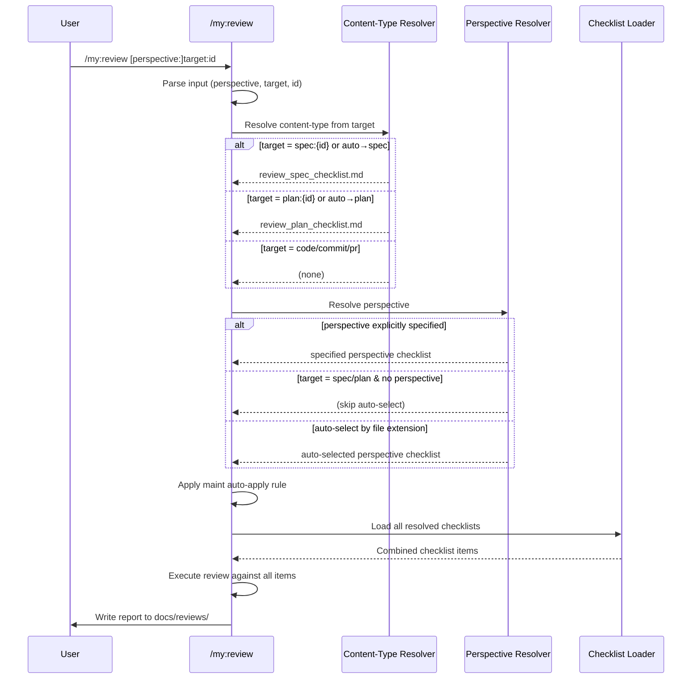
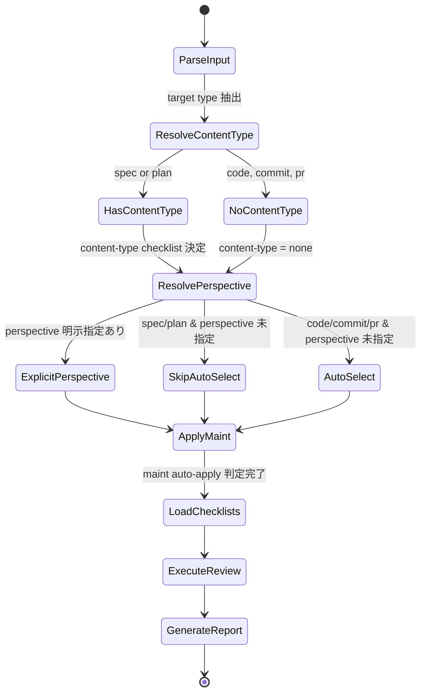

# Specification: Review Document Content-Aware Enhancement

## 1. Overview

### 1.1 Purpose

`/my:review` コマンドで技術文書（仕様書・計画書・調査書）をレビューする際に、文書の種類に応じた **content-type checklist** を自動適用し、文書の「内容品質」を評価する機能を追加する。

現在は `.md` ファイルが一律 `doc:` perspective に解決され、「ドキュメンテーション品質（書き方）」の観点のみが適用される。本機能により、仕様書なら「要件の完全性・曖昧さの排除・検証可能性」、計画書なら「タスク分解の妥当性・依存関係・リスク評価」といった「内容品質（中身）」の観点を自動で追加する。

### 1.2 Scope

| In Scope | Out of Scope |
|----------|--------------|
| `review_spec_checklist.md` の新規作成 | `research:` target type の新設 |
| `review_plan_checklist.md` の新規作成 | `review_research_checklist.md`（将来対応） |
| content-type 判定ロジックの追加（target type ベース） | perspective auto-select の文書内容ベース判定 |
| `8_review.md` プロンプトの更新 | Gemini review (`review.toml`) の同期対応 |
| `review_template.md` への content-type セクション追加 | 既存 `doc:` チェックリストの改訂 |

### 1.3 References

- Research Document: `docs/research/20260407-review-doc-content-aware.md`
- Review Prompt: `prompts/8_review.md`
- Existing Checklists: `prompts/templates/checklists/review_*_checklist.md`
- Review Template: `prompts/templates/review_template.md`

---

## 2. User Stories

### US-001: 仕様書の内容品質レビュー

**As a** 仕様書作成者
**I want** `/my:review spec:{id}` 実行時に仕様書固有のレビュー観点が自動適用される
**So that** 要件の完全性・曖昧さ・検証可能性を客観的に評価できる

**Acceptance Criteria:**
- [ ] AC-001: `spec:{id}` 指定時、`review_spec_checklist.md` が自動で読み込まれる
- [ ] AC-002: 仕様書チェックリストは Completeness / Clarity / Correctness / Verifiability / Traceability の 5 カテゴリで構成される
- [ ] AC-003: 既存の perspective checklist（auto-select or 明示指定）と content-type checklist が両方適用される
- [ ] AC-004: レビューレポートに content-type セクションが含まれる

### US-002: 計画書の内容品質レビュー

**As a** 計画書作成者
**I want** `/my:review plan:{id}` 実行時に計画書固有のレビュー観点が自動適用される
**So that** タスク分解・依存関係・リスク評価を体系的にチェックできる

**Acceptance Criteria:**
- [ ] AC-001: `plan:{id}` / `plan:fix:{id}` / `plan:refactor:{id}` / `plan:change:{id}` 指定時、`review_plan_checklist.md` が自動で読み込まれる
- [ ] AC-002: 計画書チェックリストは Structure / Feasibility / Completeness / Clarity / Risk Management の 5 カテゴリで構成される
- [ ] AC-003: perspective との組み合わせが正常に機能する（例: `be:plan:user-auth`）

### US-003: 自動検出時の content-type 適用

**As a** `/my:review` ユーザー
**I want** `{id}` のみ指定（auto-detect）した場合でも、解決先が spec/plan なら content-type checklist が適用される
**So that** target type を明示的に指定しなくても適切なレビューが受けられる

**Acceptance Criteria:**
- [ ] AC-001: `{id}` が `docs/specs/{id}.md` に解決された場合、`review_spec_checklist.md` が適用される
- [ ] AC-002: `{id}` が `docs/plans/*/{id}.md` に解決された場合、`review_plan_checklist.md` が適用される

### US-004: 後方互換性の維持

**As a** 既存の `/my:review` ユーザー
**I want** code / commit / pr レビューが変わらず動作する
**So that** 既存のワークフローが壊れない

**Acceptance Criteria:**
- [ ] AC-001: `code:{id}` / `commit:{hash}` / `pr:{number}` に content-type checklist は適用されない
- [ ] AC-002: 明示的に `doc:spec:{id}` と指定した場合、`doc:` perspective + `spec` content-type 両方が適用される
- [ ] AC-003: 既存の perspective + maint auto-apply ルールに影響しない

---

## 3. Interface Design

### 3.1 コマンドインターフェース（変更なし）

既存の `/my:review` コマンド構文はそのまま維持。内部ロジックのみ変更。

```
/my:review [perspective:]target[:subtype]:identifier
```

### 3.2 チェックリスト適用ロジック（新規）

レビュー実行時に適用されるチェックリストの決定ロジック:

```
applied_checklists = [
  content_type_checklist(target_type),   # NEW: target type から自動選択
  perspective_checklist(perspective),     # EXISTING: perspective から選択
  maint_checklist_if_applicable(),        # EXISTING: auto-apply ルール
]
```

### 3.3 Content-Type チェックリスト選択ルール

| Target Type | Content-Type Checklist | 備考 |
|-------------|----------------------|------|
| `spec:{id}` | `review_spec_checklist.md` | |
| `plan:{id}` | `review_plan_checklist.md` | |
| `plan:fix:{id}` | `review_plan_checklist.md` | |
| `plan:refactor:{id}` | `review_plan_checklist.md` | |
| `plan:change:{id}` | `review_plan_checklist.md` | |
| `code:{id}` | なし | 既存 perspective で十分 |
| `commit:{hash}` | なし | 既存 commit checklist で十分 |
| `pr:{number}` | なし | 既存 PR checklist で十分 |
| `{id}` (auto → spec) | `review_spec_checklist.md` | auto-detect 結果に従う |
| `{id}` (auto → plan) | `review_plan_checklist.md` | auto-detect 結果に従う |

### 3.4 Perspective Auto-Select の変更

技術文書（spec, plan）の場合、ファイル拡張子ベースの auto-select は `.md` → `doc:` に解決されるが、この挙動を以下のように変更する:

| 条件 | 現在の挙動 | 変更後の挙動 |
|------|-----------|-------------|
| `spec:{id}` で perspective 未指定 | `doc:` + `maint:` | perspective auto-select をスキップし、content-type (`spec`) + `maint:` のみ |
| `plan:{id}` で perspective 未指定 | `doc:` + `maint:` | perspective auto-select をスキップし、content-type (`plan`) + `maint:` のみ |
| `be:spec:{id}` で perspective 明示 | `be:` + `maint:` | `be:` + content-type (`spec`) + `maint:` |

**理由:** spec/plan は「ドキュメンテーション品質」よりも「内容品質」が重要であり、`doc:` チェックリスト（API 仕様の網羅性、サンプルコードの確認等）は不適切。perspective を明示した場合のみ、その perspective を追加する。

---

## 4. Data Models

### 4.1 Checklist File: `review_spec_checklist.md`

IEEE 830 / ISO/IEC/IEEE 29148 に準拠した仕様書レビュー観点。15-25 項目。

```markdown
# Specification Review Checklist

## Completeness (完全性)
- [ ] すべての必須セクション（Overview, User Stories, Interface, Data Models, Edge Cases）が存在するか
- [ ] 各ユーザーストーリーに受入基準（Acceptance Criteria）が定義されているか
- [ ] スコープが明確に定義され、In Scope / Out of Scope が区別されているか
- [ ] エッジケースとエラーケースが網羅的に列挙されているか
- [ ] 前提条件と制約条件が明記されているか

## Clarity (明確性)
- [ ] 各要件が一つの解釈のみ可能か（「適切な」「十分な」等の曖昧表現を排除）
- [ ] 用語が文書全体で一貫して使用されているか
- [ ] 略語・専門用語に定義や初出時の説明があるか
- [ ] 数値的な基準が具体的か（「高速」→「200ms 以内」）

## Correctness (正確性)
- [ ] 要件間に矛盾がないか
- [ ] 参照先（Research Document 等）の内容と整合しているか
- [ ] 技術的に実現可能な要件のみが含まれているか
- [ ] データモデルとインターフェース定義が整合しているか

## Verifiability (検証可能性)
- [ ] 各要件がテストで確認可能か（主観的基準を排除）
- [ ] 受入基準が「完了」か「未完了」かを判定できる形式か
- [ ] パフォーマンス要件に測定方法が記載されているか

## Traceability (追跡可能性)
- [ ] Research Document への参照が含まれているか
- [ ] 各要件の根拠・出典が明確か
- [ ] 関連する既存機能・文書へのリンクがあるか
```

### 4.2 Checklist File: `review_plan_checklist.md`

PMBOK / Agile に準拠した計画書レビュー観点。15-25 項目。

```markdown
# Plan Review Checklist

## Structure (構造)
- [ ] タスクが適切な粒度に分解されているか（1タスク = 1つの明確な成果物）
- [ ] タスク間の依存関係が明示されているか
- [ ] 実装順序が依存関係と整合しているか
- [ ] フェーズ分けがある場合、各フェーズの完了条件が定義されているか

## Feasibility (実現可能性)
- [ ] 各タスクの技術的アプローチが具体的か（「実装する」ではなく「○○を使って△△を実装する」）
- [ ] 既存コードベースとの統合ポイントが特定されているか
- [ ] 必要な外部依存（ライブラリ、API 等）が明記されているか
- [ ] 技術的リスクが特定され、軽減策が記載されているか

## Completeness (完全性)
- [ ] エラーハンドリングのタスクが含まれているか
- [ ] テスト実装のタスクが含まれているか
- [ ] ロールバック戦略または失敗時の対応が記載されているか
- [ ] 受入基準（完了条件）が定義されているか
- [ ] 変更対象のファイルパスが明記されているか

## Clarity (明確性)
- [ ] 各ステップの説明が具体的で、別の開発者が実装可能なレベルか
- [ ] 曖昧な指示（「適宜対応する」「必要に応じて」）が排除されているか
- [ ] 変更内容が「何を」「どこで」「どのように」の 3 点で記述されているか

## Risk Management (リスク管理)
- [ ] 破壊的変更（Breaking Changes）が特定されているか
- [ ] 後方互換性への影響が評価されているか
- [ ] パフォーマンスへの影響が考慮されているか
- [ ] 段階的なデプロイ・マイグレーション戦略があるか（必要な場合）
```

### 4.3 ファイル配置

```
prompts/templates/checklists/
├── review_be_checklist.md          # existing
├── review_commit_checklist.md      # existing
├── review_doc_checklist.md         # existing
├── review_fe_checklist.md          # existing
├── review_maint_checklist.md       # existing
├── review_perf_checklist.md        # existing
├── review_plan_checklist.md        # NEW
├── review_pr_checklist.md          # existing
├── review_security_checklist.md    # existing
└── review_spec_checklist.md        # NEW
```

---

## 5. System Flow

### 5.1 チェックリスト決定フロー（Sequence Diagram）



### 5.2 チェックリスト適用の状態遷移図



---

## 6. Edge Cases & Error Handling

| Scenario | Expected Behavior | 備考 |
|----------|-------------------|------|
| `doc:spec:{id}` — perspective と content-type の両方指定 | `doc:` checklist + `spec` content-type checklist + `maint:` checklist の 3 つを適用 | 重複項目があってもそのまま適用（チェックリストが異なる観点のため） |
| `security:spec:{id}` — standalone perspective + content-type | `security:` checklist + `spec` content-type checklist を適用（maint は適用しない） | security/perf の standalone ルールは維持 |
| `maint:spec:{id}` — maint 明示指定 + content-type | `maint:` checklist + `spec` content-type checklist を適用 | |
| `{id}` が spec と plan の両方に存在 | 既存のエラー処理（`error-multiple-targets`）で target type 指定を促す | 変更なし |
| content-type checklist ファイルが見つからない | content-type なしとして扱い、既存の perspective + maint のみで実行 | graceful degradation |

---

## 7. Security Considerations

### 7.1 Authentication
該当なし（ローカル CLI ツール）

### 7.2 Authorization
該当なし

### 7.3 Data Protection
該当なし

---

## 8. Performance Requirements

| Metric | Target | Measurement Method |
|--------|--------|--------------------|
| チェックリスト読み込み時間 | 既存と同等（追加 1-2 ファイル） | 体感レベルの劣化なし |
| プロンプトサイズ増加 | content-type checklist 追加で +500-800 tokens | チェックリスト 15-25 項目に制限 |

---

## 9. Testing Strategy

### 9.1 Manual Testing

以下の組み合わせで `/my:review` を実行し、正しいチェックリストが適用されることを確認:

| Test Case | Command | Expected Checklists |
|-----------|---------|-------------------|
| TC-001 | `/my:review spec:user-auth` | spec + maint |
| TC-002 | `/my:review plan:user-auth` | plan + maint |
| TC-003 | `/my:review plan:fix:user-auth` | plan + maint |
| TC-004 | `/my:review be:spec:user-auth` | spec + be + maint |
| TC-005 | `/my:review security:plan:user-auth` | plan + security (maint なし) |
| TC-006 | `/my:review code:user-auth` | (content-type なし) + auto-select perspective + maint |
| TC-007 | `/my:review commit:HEAD` | (content-type なし) + auto-select perspective |
| TC-008 | `/my:review user-auth` (auto→spec) | spec + maint |
| TC-009 | `/my:review doc:spec:user-auth` | spec + doc + maint |

### 9.2 Regression Testing

- 既存の `code:` / `commit:` / `pr:` レビューが変わらず動作すること
- perspective + maint auto-apply ルールが既存ケースで変更されないこと

---

## 10. Implementation Notes

### 10.1 変更対象ファイル

| File | Change Type | Description |
|------|-------------|-------------|
| `prompts/templates/checklists/review_spec_checklist.md` | **新規** | 仕様書レビューチェックリスト |
| `prompts/templates/checklists/review_plan_checklist.md` | **新規** | 計画書レビューチェックリスト |
| `prompts/8_review.md` | **修正** | content-type 判定ステップの追加、チェックリスト読み込みテーブルの更新 |
| `prompts/templates/review_template.md` | **修正** | content-type セクションの追加 |

### 10.2 `8_review.md` の主要変更箇所

1. **Step 1 (Parse Input)** に content-type 判定ロジックを追加
2. **Step 2 (Load Checklist)** に content-type チェックリストの読み込みテーブルを追加
3. **Auto-Selection Rules** に spec/plan の場合のスキップロジックを追加
4. perspective list の決定ロジックを拡張:
   ```
   # 現在
   perspective_list = [perspective, maint_if_applicable]

   # 変更後
   checklist_list = [content_type_checklist, perspective_checklist, maint_if_applicable]
   ```

### 10.3 `review_template.md` の変更

Detailed Findings セクションに content-type セクションを perspective セクションより前に配置:

```markdown
## Detailed Findings

### [content-type] {Spec|Plan} Content Review   ← NEW (content-type がある場合のみ)
...

### [{perspective}] {Perspective Name} Review    ← EXISTING
...

### [maint] Maintainability Review               ← EXISTING
...
```

---

## 11. Open Items

- [ ] Q1: `research:` target type を将来的に新設するかの判断（本仕様のスコープ外だが設計に影響）
- [ ] Q2: content-type checklist と perspective checklist のレポート内表示順序 → **本仕様では content-type を先に配置する方針**
- [ ] Q3: `doc:` perspective の既存チェックリストは改訂不要（content-type とは評価軸が異なるため共存可能）
- [ ] Q4: Gemini review への同期対応は本仕様のスコープ外

---
**Created:** 2026-04-07
**Last Updated:** 2026-04-07
**Status:** Draft
**Author:** Claude
