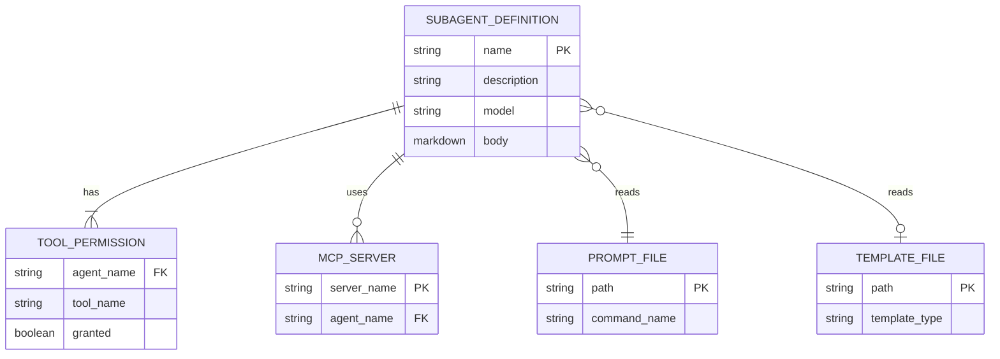
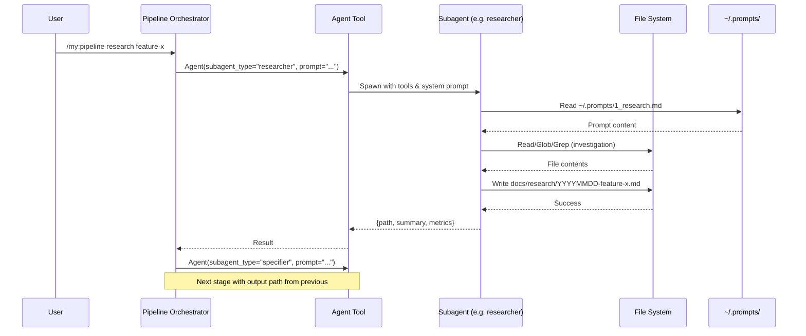
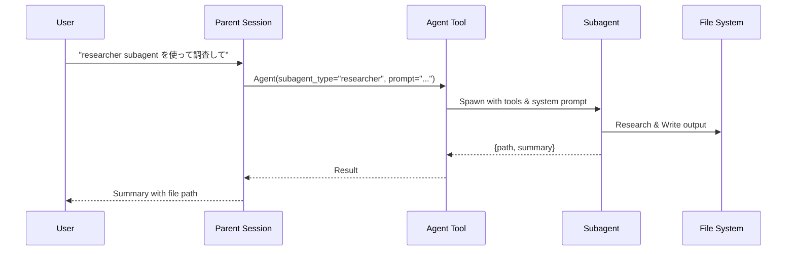
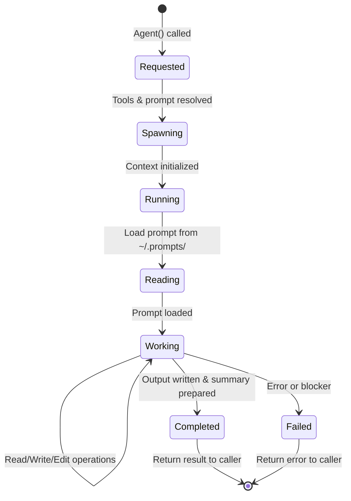

# Specification: Subagent Design for Command Pipeline

## 1. Overview

### 1.1 Purpose
既存コマンド群（research, spec, plan, do, review）を独立したコンテキストで実行可能な subagent として定義し、コンテキスト汚染の排除・最小権限の実現・パイプライン化の基盤を構築する。

### 1.2 Scope

| In Scope | Out of Scope |
|----------|--------------|
| 6つの主要 subagent 定義（researcher, specifier, planner, implementer, reviewer, fixer） | パイプラインオーケストレーター自体の実装（別仕様: pipeline-orchestration） |
| ツール割り当て戦略の確定 | 拡張 subagent（debugger, refactorer, change-analyzer, gemini-executor） |
| 既存 `/my:*` コマンドとの統合方針 | 既存 `/my:*` コマンドの subagent 呼び出しへの書き換え |
| subagent 定義ファイルの構造・命名規則 | MCP サーバーの新規追加・設定変更 |
| モデル選択戦略の初期方針 | 運用データに基づくモデル最適化 |

### 1.3 References
- Research Document: `docs/research/20260407-subagent-design.md`
- Related: `docs/research/20260407-pipeline-orchestration.md`

---

## 2. User Stories

### US-001: 独立コンテキストでのコマンド実行
**As a** 開発者
**I want** 各コマンド（research, spec, plan, do, review）を独立した subagent として実行する
**So that** コンテキスト汚染を防ぎ、トークン消費と出力品質を最適化できる

**Acceptance Criteria:**
- [ ] AC-001: 各 subagent が独立したコンテキストウィンドウで実行される
- [ ] AC-002: subagent 実行後、親セッションのコンテキストに不要なトークンが残らない
- [ ] AC-003: 各 subagent が対応する `.prompts/*.md` を Read して指示に従う

### US-002: 最小権限によるツールアクセス
**As a** 開発者
**I want** 各 subagent が必要最小限のツールのみ使用できる
**So that** 意図しないファイル変更やコマンド実行を防止できる

**Acceptance Criteria:**
- [ ] AC-001: reviewer subagent が Edit/Bash ツールを使用できないこと
- [ ] AC-002: specifier subagent が Bash/WebSearch ツールを使用できないこと
- [ ] AC-003: fixer subagent が Bash ツールを使用できないこと

### US-003: パイプラインからの subagent 呼び出し
**As a** 開発者
**I want** パイプラインオーケストレーターから Agent ツール経由で各 subagent を起動できる
**So that** research → spec → plan → do → review の自動化フローを実現できる

**Acceptance Criteria:**
- [ ] AC-001: 各 subagent が `subagent_type` パラメータで指定可能
- [ ] AC-002: subagent の出力パスが既存ディレクトリ構造（`docs/research/`, `docs/specs/` 等）に準拠
- [ ] AC-003: subagent が完了時にファイルパスと要約を返却する

### US-004: 単独利用とパイプライン利用の両立
**As a** 開発者
**I want** subagent を単独で呼び出すことも、パイプラインの一部として呼び出すこともできる
**So that** 柔軟にワークフローを選択できる

**Acceptance Criteria:**
- [ ] AC-001: 既存の `/my:*` コマンドが引き続き動作すること（後方互換性）
- [ ] AC-002: subagent が description に基づき Claude Code の自動委譲で起動可能
- [ ] AC-003: 明示的に「researcher subagent を使って」と指示した場合に起動可能

### US-005: レビュー指摘の自動反映
**As a** 開発者
**I want** レビュー結果を fixer subagent で自動的に対象ファイルに反映できる
**So that** レビュー → 修正のサイクルを効率化できる

**Acceptance Criteria:**
- [ ] AC-001: fixer がレビュー報告書の Critical/Medium 指摘を読み取り修正を適用
- [ ] AC-002: Low 優先度の指摘は無視される
- [ ] AC-003: 元のドキュメント構造・スタイルが維持される

### US-006: モデル選択の柔軟性
**As a** 開発者
**I want** 各 subagent のモデルを独立して設定できる
**So that** タスク特性に応じたコスト最適化が可能になる

**Acceptance Criteria:**
- [ ] AC-001: 各 subagent 定義ファイルに `model` フィールドが存在する
- [ ] AC-002: `inherit` 指定で親セッションのモデルを継承できる
- [ ] AC-003: `sonnet` 等の具体的モデル指定で上書きできる

---

## 3. Interface Design

### 3.1 Subagent Definition Interface

各 subagent は `.claude/agents/{name}.md` ファイルとして定義される。以下の frontmatter スキーマに従う:

```yaml
---
name: string          # (required) kebab-case, agent の識別名
description: string   # (required) 自動委譲用の説明文
tools: list           # (required) YAML list of tool names
model: string         # (optional) "inherit" | "sonnet" | "opus" | "haiku"
mcpServers: string    # (optional) comma-separated MCP server names
---
```

### 3.2 Subagent Invocation Interface

パイプラインオーケストレーターまたは親セッションからの呼び出し:

```
Agent(
  subagent_type: "{agent-name}",   # e.g. "researcher"
  prompt: "{task description with parameters}",
  model: "{optional override}"
)
```

### 3.3 Subagent Return Interface

各 subagent は完了時に以下の情報を含むメッセージを返却:

```
output_path: string    # 生成ファイルの絶対パス
summary: string        # 実行結果の要約（1-3 sentences）
metrics: object        # 任意のメトリクス（user stories count, issues found 等）
```

---

## 4. Data Models

### 4.1 Entity: SubagentDefinition

| Field | Type | Required | Description |
|-------|------|----------|-------------|
| name | string | Yes | Agent 識別名（kebab-case） |
| description | string | Yes | 自動委譲判定用の説明文 |
| tools | string[] | Yes | 許可ツールリスト |
| model | string | No | モデル指定（default: inherit） |
| mcpServers | string[] | No | MCP サーバーリスト |
| body | markdown | Yes | System prompt（Role + Instructions） |

### 4.2 Entity: ToolPermissionMatrix

| Field | Type | Required | Description |
|-------|------|----------|-------------|
| agent_name | string | Yes | 対象 agent 名 |
| tool_name | string | Yes | ツール名 |
| granted | boolean | Yes | 付与状態 |
| rationale | string | No | 付与/非付与の理由 |

### 4.3 Entity Relationships



---

## 5. System Flow

### 5.1 Sequence Diagram: Subagent Invocation (Pipeline)



### 5.2 Sequence Diagram: Subagent Invocation (Standalone)



### 5.3 State Diagram: Subagent Lifecycle



---

## 6. Detailed Subagent Specifications

### 6.1 researcher

| Property | Value |
|----------|-------|
| Name | `researcher` |
| Prompt | `~/.prompts/1_research.md` |
| Tools | Read, Glob, Grep, Write, Bash, WebSearch, WebFetch |
| Model | inherit |
| MCP | modular-mcp (gemini-grounded-search) |
| Output | `docs/research/YYYYMMDD-{id}.md` |

**System Prompt Structure:**
1. Read prompt at `~/.prompts/1_research.md` and follow it exactly
2. Use WebSearch/WebFetch/MCP for external investigation
3. Write output to `docs/research/YYYYMMDD-{id}.md`
4. Return: file path, key findings summary, open questions count

### 6.2 specifier

| Property | Value |
|----------|-------|
| Name | `specifier` |
| Prompt | `~/.prompts/2_spec.md` |
| Template | `~/.prompts/templates/spec_template.md` |
| Tools | Read, Glob, Grep, Write |
| Model | inherit |
| Output | `docs/specs/{id}.md` |

**System Prompt Structure:**
1. Read prompt at `~/.prompts/2_spec.md` and follow it exactly
2. Read template at `~/.prompts/templates/spec_template.md`
3. Read research document as input
4. Write output to `docs/specs/{id}.md`
5. Return: file path, user stories count, data models count

### 6.3 planner

| Property | Value |
|----------|-------|
| Name | `planner` |
| Prompt | `~/.prompts/3_plan.md` |
| Template | `~/.prompts/templates/plan_template.md` |
| Tools | Read, Glob, Grep, Write, Bash |
| Model | inherit |
| Output | `docs/plans/{type}/{id}.md` |

**System Prompt Structure:**
1. Read prompt at `~/.prompts/3_plan.md` and follow it exactly
2. Investigate codebase with Glob, Grep, Bash (`tree`, `wc`)
3. Break down into phases: Foundation → Core Logic → Integration → Testing
4. Write output to `docs/plans/{type}/{id}.md`
5. Return: file path, phase count, task count

### 6.4 implementer

| Property | Value |
|----------|-------|
| Name | `implementer` |
| Prompt | `~/.prompts/7_do.md` |
| Tools | Read, Glob, Grep, Write, Edit, Bash |
| Model | sonnet |
| Output | Source code changes |

**System Prompt Structure:**
1. Read prompt at `~/.prompts/7_do.md` and follow it exactly
2. Read plan document as input
3. Execute phase-by-phase, running lint/test after each phase
4. Do NOT make changes outside the plan scope
5. Return: summary of changes, test results, blockers (if any)

### 6.5 reviewer

| Property | Value |
|----------|-------|
| Name | `reviewer` |
| Prompt | `~/.prompts/8_review.md` |
| Checklists | `~/.prompts/templates/checklists/` |
| Tools | Read, Glob, Grep, Write |
| Model | opus |
| Output | `docs/reviews/{target_type}/{perspective}/{id}.md` |

**System Prompt Structure:**
1. Read prompt at `~/.prompts/8_review.md` and follow it exactly
2. Load perspective-specific checklist from `~/.prompts/templates/checklists/`
3. Evaluate: PASS / WARNING / ISSUE per checklist item
4. Write output to `docs/reviews/{target_type}/{perspective}/{id}.md`
5. Return: file path, pass/warning/issue counts

### 6.6 fixer

| Property | Value |
|----------|-------|
| Name | `fixer` |
| Tools | Read, Glob, Grep, Write, Edit |
| Model | sonnet (simpler task, cost optimization) |
| Output | Modified target files |

**System Prompt Structure:**
1. Read review report and target file(s)
2. Process only Critical and Medium priority issues
3. Ignore Low priority issues
4. Preserve original document structure and style
5. Return: list of fixes applied, files modified

---

## 7. Tool Permission Matrix

| Tool | researcher | specifier | planner | implementer | reviewer | fixer |
|------|-----------|-----------|---------|-------------|----------|-------|
| Read | Yes | Yes | Yes | Yes | Yes | Yes |
| Glob | Yes | Yes | Yes | Yes | Yes | Yes |
| Grep | Yes | Yes | Yes | Yes | Yes | Yes |
| Write | Yes | Yes | Yes | Yes | Yes | Yes |
| Edit | No | No | No | Yes | No | Yes |
| Bash | Yes | No | Yes | Yes | No | No |
| WebSearch | Yes | No | No | No | No | No |
| WebFetch | Yes | No | No | No | No | No |

**Rationale:**
- **Read/Write**: All agents need to read inputs and write outputs
- **Glob/Grep**: All agents need codebase exploration
- **Edit**: Only agents that modify existing files (implementer, fixer)
- **Bash**: Only agents that need shell execution (researcher for MCP, planner for `tree`/`wc`, implementer for lint/test)
- **WebSearch/WebFetch**: Only researcher needs external investigation

---

## 8. Edge Cases & Error Handling

| Scenario | Expected Behavior | Handling Strategy |
|----------|-------------------|-------------------|
| Prompt file not found (`~/.prompts/*.md`) | Subagent reports error and terminates | Use absolute path `~/.prompts/`. Parent session can pre-validate |
| Input document not found | Subagent reports missing file path and terminates | Return error message with expected path |
| Output directory does not exist | Create directory before writing | Use `mkdir -p` equivalent via Write tool |
| Tool permission denied at runtime | Subagent reports blocked operation | Log which tool was denied, suggest adding to tools list |
| MCP server unavailable (researcher) | Fallback to WebSearch/WebFetch only | researcher can function without MCP, quality may degrade |
| Subagent exceeds context window | Output may be truncated | Keep system prompts thin (delegate to `.prompts/*.md` via Read) |
| Fixer encounters ambiguous review item | Skip the item, report as unresolved | Return list of skipped items in summary |

---

## 9. Security Considerations

### 9.1 Tool Access Control
- 各 subagent は frontmatter の `tools` フィールドで明示的に許可されたツールのみ使用可能
- Edit/Bash は必要な subagent にのみ付与（最小権限の原則）

### 9.2 File System Access
- subagent は制限なくファイルシステムにアクセス可能（Claude Code の sandbox 内）
- 出力パスは既存のディレクトリ規約に従う（`docs/` 配下）
- `.env`, credentials 等のセンシティブファイルへの書き込みは subagent の role で制限

### 9.3 MCP Server Access
- `mcpServers` は必要な subagent（researcher）にのみスコープ指定
- 不要な subagent に MCP アクセスを付与しない

---

## 10. Performance Requirements

| Metric | Target | Measurement Method |
|--------|--------|--------------------|
| Subagent spawn time | < 5s | Time from Agent() call to first tool use |
| Prompt load time | < 1s | Time to Read ~/.prompts/*.md |
| Context overhead | < 2000 tokens | System prompt size (excluding loaded prompt) |

---

## 11. Directory Structure

```
.claude/agents/
├── researcher.md       # research phase
├── specifier.md        # spec phase
├── planner.md          # plan phase
├── implementer.md      # do phase
├── reviewer.md         # review phase
└── fixer.md            # review fix phase
```

---

## 12. Testing Strategy

### 12.1 Unit Tests
- 各 subagent 定義ファイルの frontmatter が正しいスキーマに従っているか検証
- tools フィールドが有効なツール名のみ含むか検証

### 12.2 Integration Tests
- 各 subagent を単独で呼び出し、正しいファイルが生成されるか検証
- subagent が対応する `.prompts/*.md` を正常に読み込めるか検証

### 12.3 E2E Tests
- パイプラインオーケストレーターから全 subagent を順次呼び出し、全ステージが完了するか検証
- 出力ファイルが既存ディレクトリ構造に準拠しているか検証

---

## 13. Open Items
- [ ] Q1: subagent 定義をプロジェクトローカル（`.claude/agents/`）に置くか、グローバル（`~/.claude/agents/`）に置くか
- [ ] Q2: reviewer の model は初期から sonnet にすべきか、inherit で始めるか
- [ ] Q3: fixer subagent の修正サイクル上限（1回 vs 最大3回）
- [ ] Q4: skills フィールドで mgrep skill を注入すべきか
- [ ] Q5: subagent 内で gemini-grounded-search を使う場合の MCP サーバー名指定方法
- [ ] Q6: 将来的に `/my:*` コマンド自体を subagent 呼び出しにラップすべきか

---
**Created:** 2026-04-07
**Last Updated:** 2026-04-07
**Status:** Draft
