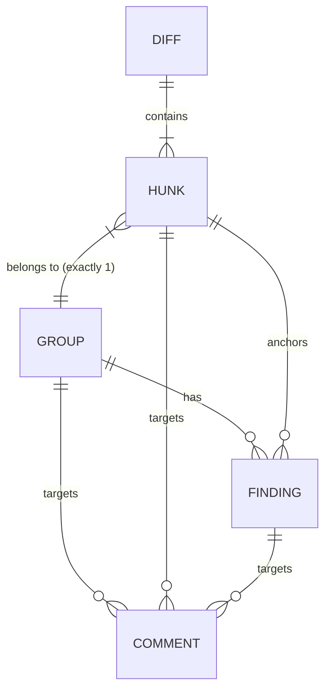
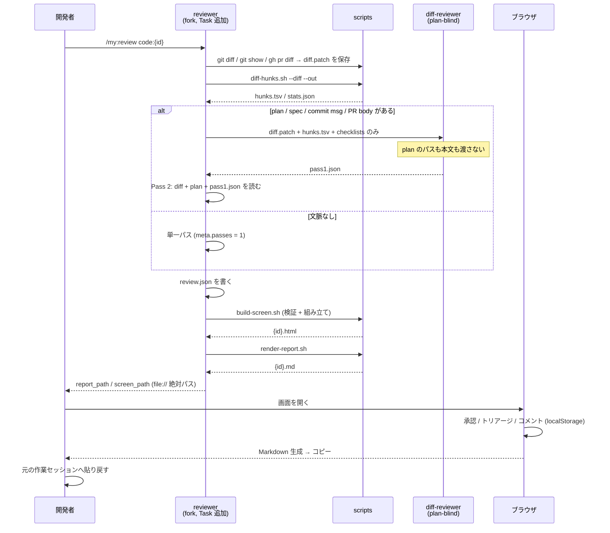

# Specification: 解説つき diff レビュー画面

## 1. Overview

### 1.1 Purpose

`/my:review` の diff 系ターゲット (`code:` / `commit:` / `pr:`) に、
**解説つきの単一 HTML レビュー画面**と、**忖度対策の 2 段階レビュー**を追加する。

レビュアー (人間) は生成された HTML を `file://` で開き、変更グループごとの意図を
読みながら承認を進め、LLM の指摘を採用 / 却下し、気づいたことをその場でコメントし、
最後に「採用された指摘 + 自分のコメント」を 1 つの Markdown にまとめて
元の作業セッションへ貼り戻す。

設計の中核は **「機械的なデータ」と「判断」の分離**である。差分の本文・行番号・
hunk 採番・統計はスクリプトが決定的に扱い、LLM は変更グループ・意図の解説・
リスク・指摘という**判断だけ**を JSON で出力する。これにより LLM の出力量が
差分サイズに比例しなくなり、画面の品質もレビューごとに揺れなくなる。

### 1.2 Scope

| In Scope | Out of Scope |
|----------|--------------|
| `code:` / `commit:` / `pr:` ターゲットの HTML 画面生成 | `spec:` / `plan:` / `prd:` / `pspec:` の doc レビュー (現状の md 出力のまま) |
| 2 段階レビュー (plan-blind → plan 照合) | 3 段階以上、複数モデルによるレビュー |
| 変更グループ化・意図解説・リスク順表示 | AST 解析やコールグラフによる自動グループ化 |
| グループ単位の承認・指摘のトリアージ・任意箇所へのコメント | 複数人の同時レビュー、コメントのサーバ保存、レビュー履歴の集計 |
| 採用指摘 + コメント → Markdown 生成 + クリップボードコピー | GitHub PR への自動コメント投稿 (Q3 で初版スコープ外と決定) |
| md レポート (`{id}.md`) の継続生成 | fixer が HTML / JSON を直接読むようにする変更 |
| bash + awk + jq のみで動くスクリプト群 | Node / Python / pnpm / 常駐サーバ / ネットワークアクセス |
| 大規模差分の折りたたみによる実用化 | 仮想スクロールによる本格的な描画最適化 |

### 1.3 References

- Research Document: `docs/research/20260725-diff-review-screen.md`
- 一次情報: https://x.com/catnose99/status/2080650223551156411 /
  https://x.com/catnose99/status/2080568062563201436 /
  https://x.com/catnose99/status/2080859838658257186 (単一 HTML の確認)
- 先行 OSS: https://github.com/yoshiko-pg/difit (研究 §6.5 で比較・不採用)

### 1.4 Assumptions

研究ドキュメントの A1–A4 に加え、本仕様で決定した事項。

なお A1 (単一 HTML) は追加調査で**一次情報として確定**した — catnose 本人が
「はい、htmlベースです」「(css も) 同じファイルに含めています」と回答している
(研究 §6.2.1)。同時に「そのあたりの実装は Codex 任せ」とも述べており、
**HTML の組み立て方は本人も設計していない**。よって §3.4.2 以降の
テンプレ / ペイロード契約は本仕様の独自設計である (参照できる実装は存在しない)。

- **AS-01. Pass 1 は真のサブエージェント分離で行う。**
  同一エージェント内の「plan を後で読む」順序制御では、プロンプトに plan 文脈が
  混入した時点で blind ではなくなる。よって `agents/reviewer.md` に `Task` ツールを
  追加し、plan を渡さない専用サブエージェント (`agents/diff-reviewer.md`) を起動する。
  (研究 §6.2「1回目はplanを知らないサブエージェント」の要件を満たす唯一の方法)
- **AS-02. 2 段階にするのは「忖度の対象」が存在するときだけ。**
  plan / spec / commit message / PR description のいずれも無いターゲットでは
  レビュアー自身がすでに blind なので、単一パスで実行しグルーピングも同時に行う。
  サイズ閾値ではなく**文脈の有無**で分岐する (恣意的な閾値を持ち込まない)。
- **AS-03. リスク語彙は既存の Critical / High / Medium / Low に統一する。**
  catnose の画面は「要注意 / 注意 / 低リスク」の 3 段だが、ツールキットは
  `skills/review/SKILL.md:16-26` で 4 段を単一の真実としており、
  fixer / pipeline のゲート条件もこれに依存している。画面の表示ラベルだけを
  日本語にし、値は 4 段のまま扱う。
- **AS-04. `review.json` を単一ソースとし、`{id}.md` はそこから生成する。**
  レビュアーが md と JSON を二重に書くと、同じ本文にトークンを 2 度払い、
  かつ食い違いが起きうる。md のフォーマットは既存 `template.md` と一致させ、
  fixer の入力契約 (`docs/reviews/{type}/{id}.md` を読む) を変えない。
- **AS-05. 中間生成物はプロジェクトに残さない。**
  `diff.patch` / `hunks.tsv` / `pass1.json` は
  `${TMPDIR:-/tmp}/my-review/{id}/` に置く。生成 HTML は差分を内包する
  自己完結ファイルなので、中間物を失っても画面は成立する。
- **AS-06. 記録として残るのは `{id}.md` (成果物) のみ。**
  `{id}.json` と `{id}.html` は再生成可能なビルド成果物であり、
  プロジェクト側で gitignore してよい。承認状態とコメントは localStorage
  にしか存在せず、永続化の唯一の経路は生成された Markdown である (研究 Q2)。
- **AS-07. hunk 採番は「`git diff` 出力順の `^@@` 行に通し番号」1 通りに固定する。**
  スクリプトと画面 JS の双方がこの規則だけを実装するので、両者の一致は
  構造的に保証される。

---

## 2. User Stories

### US-001: 大きな差分を意図から読む

**As a** 自分が指示した実装をレビューする開発者
**I want** 差分をファイル順ではなく「意図ごとのグループ × リスク順」で読みたい
**So that** 100 ファイル規模の差分でも、危ない変更から順に理解できる

**Acceptance Criteria:**

- [ ] AC-001: `/my:review code:{id}` の実行後、`docs/reviews/code/{id}.html` が
      生成され、`file://` で開くと外部リソースを 1 つも取得せずに描画される
      (DevTools の Network が空)。
- [ ] AC-002: セクション `01` に変更グループの一覧が表示され、各行に
      タイトル / 1 行要約 / タグ / hunk 数 / リスクラベル / 指摘数が出る。
- [ ] AC-003: グループの表示順は `review.json` の `groups` 配列順であり、
      画面は再ソートしない。
- [ ] AC-004: セクション `02` の各グループカードに `意図:` の解説文が表示され、
      その下に所属 hunk の diff が旧/新 2 列の行番号付きで表示される。
- [ ] AC-005: `intent_unclear: true` のグループには「要改善」ラベルが表示される。
- [ ] AC-006: `hunks.tsv` に現れる全 hunk が、ちょうど 1 つのグループまたは
      `ungrouped_hunks` に含まれる。含まれない hunk があるとビルドが exit 3 で失敗する。

### US-002: 忖度なしの指摘を得る

**As a** plan を書いて実装を任せた開発者
**I want** 「plan に則っているから妥当」で流されない指摘が欲しい
**So that** plan 自体が甘かった場合にもレビューで気づける

**Acceptance Criteria:**

- [ ] AC-007: plan / spec / commit message / PR description のいずれかが存在する
      ターゲットでは、Pass 1 が `agents/diff-reviewer.md` のサブエージェントで
      実行され、そのプロンプトに plan / spec のパスも本文も含まれない。
- [ ] AC-008: Pass 1 が出力した finding の `id` は、すべて最終 `review.json` の
      `findings[]` に存在する。1 つでも欠けていればビルドが exit 4 で失敗し、
      欠けた id を stderr に列挙する。
- [ ] AC-009: Pass 2 が「plan 上は意図的な変更」と判断した Pass 1 の指摘は、
      `plan_status: "justified"` となり、画面と Markdown の両方に
      「plan 上は意図的な変更だが、実装として改善を求める」の注記が出る。
- [ ] AC-010: 上記の文脈が 1 つも無いターゲットでは Pass 1 は起動されず、
      単一パスで完了する。`review.json` の `meta.passes` が `1` になる。
- [ ] AC-011: 各 finding に `source_pass` (1 または 2) が入り、画面の指摘一覧に
      出自が表示される。

### US-003: 判断とコメントをまとめて戻す

**As a** レビューを終えた開発者
**I want** 採用した指摘と自分のコメントを 1 つの Markdown で受け取りたい
**So that** 元の作業セッションに貼るだけで修正を依頼できる

**Acceptance Criteria:**

- [ ] AC-012: 各 finding に「採用 / 却下 / 未判定」の 3 状態トグルがあり、
      初期値は「未判定」。「却下」を選ぶと理由の 1 行入力が現れる。
- [ ] AC-013: グループカードに「確認して承認」チェックがあり、ヘッダに
      `承認 n/N` (N = グループ数) と進捗バーが表示される。
- [ ] AC-014: グループ / hunk の任意の行 / finding に 💬 でコメントを付けられ、
      コメント済みの対象は常時マークされる。
- [ ] AC-015: セクション `05` に `採用 n` / `却下 n` / `未判定 n` / `コメント n`
      のカウントチップが表示される。
- [ ] AC-016: 「フィードバックを生成」で §3.5 の Markdown が生成され、
      「クリップボードにコピー」で 1 クリックでコピーできる。
      コピーに失敗した環境では生成結果が全選択可能な `<textarea>` に出て
      手動コピーできる。
- [ ] AC-017: 承認・トリアージ・コメントはリロード後も復元される。
      同じ `{id}` でも差分が変わった (= `diff_sha` が変わった) 場合は
      前回の状態を読み込まず、破棄した旨を画面に表示する。

### US-004: 既存フローを壊さない

**As a** pipeline と fixer を使っている利用者
**I want** 既存の md レポートと doc レビューの挙動が変わらないこと
**So that** 自動修正サイクルがそのまま動く

**Acceptance Criteria:**

- [ ] AC-018: diff レビュー後も `docs/reviews/{type}/{id}.md` が
      `skills/review/template.md` と同じ節構成で生成される。
- [ ] AC-019: `spec:` / `plan:` / `prd:` / `pspec:` / bare ターゲットの出力は
      本変更の前後でバイト単位の差が出ない (HTML も JSON も生成されない)。
- [ ] AC-020: `--no-screen` を付けると Pass 1 も HTML 生成も行わず、
      現状と同じ単一パス + md のみになる。

---

## 3. Interface Contract

### 3.1 API Endpoints (web services only)

N/A: ネットワークサーフェスを持たない。生成物は `file://` で開く静的 HTML。

### 3.2 CLI Interface

#### 3.2.1 スキル呼び出し

```
/my:review [perspective:]<target> [--no-screen]
```

`argument-hint` を更新:
`"[perspective:]<target> [--no-screen]  e.g. code:user-auth, commit:abc1234, pr:current"`

`--no-screen` は diff 系ターゲットでのみ意味を持つ (doc 系では無視し、
その旨を 1 行報告する)。

**差分の取得はスキルの責務。** ターゲット別のコマンドは
`skills/review/SKILL.md` Step 1 の既存表に従い、出力を
`${TMPDIR:-/tmp}/my-review/{id}/diff.patch` に保存する。

| ターゲット | コマンド |
|-----------|---------|
| `code:{id}` | `git -c core.quotepath=false diff …` |
| `commit:{hash\|range}` | `git -c core.quotepath=false show {hash}` / `… diff {range}` |
| `pr:{number\|current}` | `gh pr diff {number}` (`current` は引数なし) |

`git` 系は `-c core.quotepath=false` を付け、非 ASCII パスが 8 進エスケープ
されないようにする。`gh pr diff` は GitHub API 経由で UTF-8 パスをそのまま
返すため該当オプションを持たず、また持つ必要もない。

実行した実コマンド文字列は `meta.target.diff_command` に記録する (§4.1)。

#### 3.2.2 `skills/review/scripts/diff-hunks.sh`

差分を機械的に索引する。**git を呼ばない** (上記でスキルが保存した patch を
読むだけ) ので、fixture patch でそのままテストできる。取得経路が `git diff` か
`gh pr diff` かは以降のパイプラインに影響しない — unified diff であればよい。

```
Usage: diff-hunks.sh --diff <patch-file> --out <dir>
```

| 出力 | 形式 |
|------|------|
| `<dir>/hunks.tsv` | ヘッダ無し TSV: `hunk_id \t path \t hunk_header \t old_start \t new_start` |
| `<dir>/stats.json` | `{"files":N,"hunks":N,"insertions":N,"deletions":N}` |

- `hunk_id` = `h` + ゼロ埋め連番。桁数は総 hunk 数の桁数 (最低 3)。
  例: 268 hunks → `h001`…`h268`、1200 hunks → `h0001`…
- 採番順は patch 中に `^@@` が現れる順 (= `git diff` の出力順)。
- `path` は `+++ b/<path>` 由来。削除ファイルは `--- a/<path>` 由来。
- `insertions` / `deletions` は `^+` / `^-` の行数 (`^+++` / `^---` を除く)。
- `files` は `^diff --git` の出現数。

| Exit | 意味 |
|------|------|
| 0 | 成功 |
| 1 | 引数不正 / patch ファイルが読めない |
| 2 | patch が空 (hunk 0 件) |

#### 3.2.3 `skills/review/scripts/build-screen.sh`

テンプレ + 生の diff + review JSON から単一 HTML を組み立てる。**検証も担う**。

```
Usage: build-screen.sh --diff <patch> --review <json> --out <html>
                       [--template <html>] [--pass1 <json>]
```

`--template` の既定は `${CLAUDE_SKILL_DIR}/assets/review-screen.html`。

検証 (すべて `jq` で機械判定し、違反は 1 行ずつ stderr に出す):

1. `review.json` が §4.1 のスキーマに適合する (必須キー・列挙値)。
2. 全 hunk id が `groups[].hunks` ∪ `ungrouped_hunks` にちょうど 1 回現れる。
3. `findings[].group` が存在するグループを指す。
4. `findings[].anchor.hunk` が存在する hunk を指す。
5. `severity` が `Critical|High|Medium|Low` のいずれか。
6. `meta.assessment` が「Critical/High が 1 件以上 → NEEDS_REVISION」と整合する。
7. `--pass1` 指定時: `pass1.json` の全 finding id が `findings[]` に存在する。
8. **警告のみ** (exit 0 のまま stderr へ): グループ順がリスク降順でない /
   `intent_unclear: true` のグループに finding が 1 件も無い。

| Exit | 意味 |
|------|------|
| 0 | 成功 (警告は出ていても 0) |
| 1 | 引数不正 / 入力が読めない |
| 3 | スキーマまたは参照整合性の検証失敗 (検証 1–6) |
| 4 | Pass 1 の指摘が最終結果から欠落 (検証 7) |

標準出力の最終行は `[review-screen] wrote: <abs-path> (<size>)`。

#### 3.2.4 `skills/review/scripts/render-report.sh`

```
Usage: render-report.sh --review <json> --out <md>
```

`skills/review/template.md` と同じ節構成の Markdown を出力する
(`## Metadata` / `## Findings` (severity 別) / `## Action Items` /
`## Overall Assessment` / `## Next Steps`)。finding id は
`review.json` の `id` をそのまま使う。Exit は 0 / 1 のみ。

### 3.3 Public API (libraries only)

N/A: ライブラリではない。

### 3.4 File Formats & Protocols

#### 3.4.1 出力ファイル

| パス | 役割 | 永続性 |
|------|------|--------|
| `docs/reviews/{type}/{id}.md` | 成果物 (記録・fixer 入力) | コミット対象 |
| `docs/reviews/{type}/{id}.json` | 正規データ (単一ソース) | 再生成可能 / gitignore 可 |
| `docs/reviews/{type}/{id}.html` | レビュー画面 | 再生成可能 / gitignore 推奨 (差分を内包し大きい) |
| `${TMPDIR:-/tmp}/my-review/{id}/diff.patch` | レビュー対象の差分スナップショット | 一時 |
| `${TMPDIR:-/tmp}/my-review/{id}/hunks.tsv` | hunk 索引 | 一時 |
| `${TMPDIR:-/tmp}/my-review/{id}/stats.json` | 差分統計 | 一時 |
| `${TMPDIR:-/tmp}/my-review/{id}/pass1.json` | Pass 1 の生の指摘 | 一時 |

perspective 付きターゲットは既存規約どおり `{id}--{perspective}.{md,json,html}`。

#### 3.4.2 HTML テンプレのペイロード契約

テンプレ `assets/review-screen.html` は次の 1 行だけをマーカーとして持つ。

```html
<script id="review-payload" type="application/json">
__MY_REVIEW_PAYLOAD__
</script>
```

`build-screen.sh` はこの行を awk で 1 行置換する (sed は使わない — 巨大な
置換文とメタ文字の扱いで壊れる)。ペイロードは 1 つの JSON オブジェクト:

```json
{ "diff": "<raw unified diff as a JSON string>", "review": { ... } }
```

生成手順:

```sh
jq -n --rawfile diff "$DIFF" --slurpfile review "$REVIEW" \
   '{diff:$diff, review:$review[0]}' | sed 's|</|<\\/|g'
```

`</` → `<\/` の置換は JSON 文字列として妥当なエスケープであり、これにより
差分本文中の `</script>` がブロックを終端させる事故が構造的に起きない
(研究 §7 のリスク)。画面 JS は `JSON.parse(el.textContent)` で読む。

#### 3.4.3 localStorage キー

```
my-review:{id}:{diff_sha}
```

`diff_sha` = `diff.patch` の SHA-256 先頭 12 桁 (`review.json` の
`meta.diff_sha`)。値は `{approved:{g1:true}, triage:{H001:"adopted"},
rejectReasons:{}, comments:[{anchor,body,at}]}`。
読み込み時に `my-review:{id}:` 前方一致の別キーがあれば削除し、
「前回の差分と変わったため状態を破棄しました」を画面上部に表示する。

### 3.5 生成される Markdown フォーマット

catnose の実物 (研究 §6.3(b)) を踏襲する。`## 依頼` を先頭に置くのは、
貼り戻し先のエージェントが無批判に修正を始めるのを防ぐため。

```markdown
# レビューフィードバック: {meta.title}

## 依頼

- 以下の指摘が忖度なしで妥当かどうか精査してください。妥当でないものは指摘してください
- 対応方針に迷う点があれば、実装前に確認してください

## 採用された指摘

### 1. [High] {finding.title}
- 場所: {anchor.display} [{anchor.hunk}]
- 変更グループの意図: {group.intent}
- 備考: plan 上は意図的な変更だが、実装として改善を求める     ← plan_status == "justified" のときのみ
- 指摘: {finding.impact}
- 改善案: {finding.recommendation}

## レビュアーのコメント

### C-1. {anchor 表示名} [{anchor}]
{comment.body}

## 対応不要と判断した指摘

- [Medium] {finding.title} — 却下理由: {reason}
```

- 「未判定」の指摘は出力しない (採用も却下もされていないものを流し込むと、
  貼り戻し先が全件対応を始めてしまう)。
- 採用 0 件かつコメント 0 件のときは「レビューの結果、修正依頼はありません。」
  の 1 行のみを出力する。
- 節が空になる場合、その見出しごと省略する。

---

## 4. Data Model

### 4.1 `review.json`

レビュアーが書く唯一の成果物。**差分本文・行の内容・行番号の一覧は含めない**
(NFR-003)。

| Field | Type | Required | Description |
|-------|------|----------|-------------|
| `schema_version` | int | ✓ | 現在 `1` |
| `meta.id` | string | ✓ | `{id}` (perspective 接尾辞を含まない) |
| `meta.title` | string | ✓ | 画面ヘッダのタイトル (例: 「認証リファクタの未ステージ差分レビュー」) |
| `meta.target` | object | ✓ | `{kind: "code"\|"commit"\|"pr", spec, diff_command, context_paths: []}` |
| `meta.reviewed_at` | string | ✓ | ISO 8601 |
| `meta.checklists` | string[] | ✓ | 使用した checklist ファイル名 |
| `meta.passes` | int | ✓ | `1` または `2` |
| `meta.assessment` | enum | ✓ | `PASS` \| `NEEDS_REVISION` |
| `meta.diff_sha` | string | ✓ | `diff.patch` の SHA-256 先頭 12 桁 |
| `stats` | object | ✓ | `stats.json` をそのまま転記 |
| `groups[]` | array | ✓ | 表示順 = リスク降順 |
| `groups[].id` | string | ✓ | `g1`, `g2`, … |
| `groups[].title` | string | ✓ | 意図を表す短い日本語 (例: 「URL・ホスト判定の共通基盤」) |
| `groups[].summary` | string | ✓ | 一覧に出す 1 行要約 |
| `groups[].intent` | string | ✓ | 詳細カードの `意図:` 本文。`intent_unclear` が true のときは「つかめなかった理由」を書く |
| `groups[].intent_unclear` | bool | ✓ | 意図が読み取れない場合 `true` → 「要改善」ラベル |
| `groups[].risk` | enum | ✓ | `Critical`\|`High`\|`Medium`\|`Low` (AS-03) |
| `groups[].tags` | string[] | ✓ | `refactor` / `feat` / `fix` / `test` / `docs` / `chore` など |
| `groups[].hunks` | string[] | ✓ | 所属 hunk id |
| `ungrouped_hunks` | string[] | ✓ | どのグループにも属さない hunk (空配列可) |
| `findings[]` | array | ✓ | 空配列可 |
| `findings[].id` | string | ✓ | 既存規約どおり `C001` / `H001` / `M001` / `L001` |
| `findings[].severity` | enum | ✓ | 4 段 |
| `findings[].title` | string | ✓ | 1 行の指摘名 |
| `findings[].group` | string | ✓ | グループ id |
| `findings[].anchor` | object | ✓ | `{hunk, side: "new"\|"old", line: int, file, display}` |
| `findings[].impact` | string | ✓ | 何が問題か (md の Impact) |
| `findings[].recommendation` | string | ✓ | 具体的な改善案 |
| `findings[].source_pass` | int | ✓ | `1` \| `2` |
| `findings[].plan_status` | enum | ✓ | `none` \| `justified` (plan 上は意図的だが実装として改善を求める) |
| `plan_check[]` | array | – | Pass 2 のみ。plan が無ければ省略 |
| `plan_check[].item` | string | ✓ | plan の項目 |
| `plan_check[].status` | enum | ✓ | `implemented` \| `missing` \| `deviated` \| `extra` |
| `plan_check[].note` | string | – | 補足 |
| `plan_check[].hunks` | string[] | – | 根拠 hunk |

`anchor.display` は Markdown にそのまま載る人間可読の位置表記。
形式は `{file}（{新|旧}L{line}〜）`。

### 4.2 `pass1.json`

`findings[]` の部分集合スキーマ (`id` / `severity` / `title` / `anchor` /
`impact` / `recommendation`)。`group` と `plan_status` は Pass 2 が付与するため
含まない。`schema_version` と `findings` のみを持つ。

### 4.3 Relationships



hunk → group は全射かつ一意 (AC-006)。comment は localStorage のみに存在し
`review.json` には入らない。

---

## 5. Flows

### 5.1 全体フロー



### 5.2 2 段階レビューの情報遮断

Pass 1 のサブエージェントに渡すもの / 渡さないもの:

| 渡す | 渡さない |
|------|----------|
| `diff.patch` のパス | plan / spec / analysis のパスと本文 |
| `hunks.tsv` のパス | commit message / PR description |
| 使用する checklist のパス | Pass 2 が何を見るかという文脈 |
| 出力先 `pass1.json` のパスとスキーマ | 「この実装は計画通りか」という問い |

Pass 2 の契約:

- `pass1.json` の finding は**1 件も削除しない**。
  plan で正当化できるものは `plan_status: "justified"` に変え、
  severity を 1 段下げてよいが、消すことは禁止 (AC-008 が機械検証する)。
- plan を読まないと分からない指摘 (plan 項目の未実装・逸脱) を
  `source_pass: 2` の finding として追加する。
- `plan_check[]` を埋める。`missing` / `deviated` は対応する finding を持つ。
- 変更グループ化・意図解説・リスク付けは Pass 2 が行う (差分全体を俯瞰する必要が
  あり、Pass 1 の関心とは別レイヤーのため)。

### 5.3 画面の構成

| セクション | 内容 |
|-----------|------|
| header (sticky) | `DIFF REVIEW` / `meta.title` / `N files / M hunks +I −D` / 進捗バー / `承認 n/N` / `?` |
| `01 / 変更グループ一覧` | リスク降順の一覧。行クリックで `02` の該当カードへスクロール |
| `02 / 変更グループ詳細` | リスクラベル + タイトル + `意図:` + `☐ 確認して承認` + 所属 hunk の diff + その hunk に紐づく finding のインライン表示 |
| `03 / 指摘一覧` | severity 降順。トリアージ 3 状態 / `source_pass` / `plan_status` 注記 / 該当 hunk へのジャンプ |
| `04 / plan 照合` | `plan_check[]` の表。`plan_check` が無い場合は「N/A: plan なし」を 1 行表示 |
| `05 / フィードバック組み立て` | カウントチップ / 生成ボタン / コピーボタン / 生成結果プレビュー |

表示の細部:

- diff 行は旧/新の 2 列行番号 + `+`/`−` ガター。追加行 / 削除行に淡い背景。
- hunk が 10 個を超えるグループは hunk を既定折りたたみ。
- 「確認して承認」したグループはカードを折りたたむ。
- フィルタ: severity / 「未判定のみ」/「指摘のあるグループのみ」。
- キーボード: `?` ヘルプ、`j`/`k` で hunk 移動、`a` で現在のグループを承認。
- **diff 本文とすべての LLM 生成テキストは `textContent` で挿入する**
  (`innerHTML` を使わない)。差分に含まれる HTML/JS が画面上で実行される経路を
  持たせない (§7)。

---

## 6. Edge Cases & Error Handling

| Scenario | Expected Behavior |
|----------|-------------------|
| 差分の取得自体が失敗 (`gh` 未認証 / PR が見つからない / ネットワーク不通 / 不正な commit hash) | 差分取得コマンドが非 0 で終了した時点で停止。実行したコマンドとその stderr を提示する。**「差分がありません」とは報告しない** (空差分と原因が異なり、対処も異なるため)。`diff.patch` を書かず、後続の全処理をスキップする |
| 差分が空 (`git diff` が 0 バイト) | 取得コマンドは成功、`diff-hunks.sh` が exit 2。スキルは「レビュー対象の差分がありません」と、確認したコマンドを 1 行で報告して停止。HTML は作らない |
| バイナリファイルの変更 | `Binary files … differ` は hunk を持たないので採番対象外。`stats.files` には数え、画面のグループ詳細に「バイナリ変更」として file 名のみ表示 |
| リネーム (`rename from/to`) | `path` は `+++ b/` 側。旧パスは hunk header 行の上の `rename from` から拾い、画面に `old → new` を併記 |
| 新規ファイル / 削除ファイル | `--- /dev/null` / `+++ /dev/null` を許容し、存在する側のパスを使う |
| hunk 総数が 1000 を超える | `hunk_id` の桁数が自動で 4 桁になる。画面 JS は id を文字列として扱い桁数を仮定しない |
| 極端に長い 1 行 (minified 等) | diff 行は横スクロールさせる。ページ本体は横スクロールさせない |
| 非 UTF-8 の差分 | `jq --rawfile` が失敗するため exit 1。「非 UTF-8 の差分は未対応」と該当ファイル名を報告 |
| 差分行に `</script>` が含まれる | §3.4.2 の `</` → `<\/` 置換により無害。テストで固定化 (§9) |
| plan が見つからない (`code:` だが plan なし) | AS-02 により単一パス。`plan_check` を省略し、画面 `04` は「N/A: plan なし」 |
| `pr:` で PR description が空 | commit message を文脈として扱う。それも無ければ単一パス |
| Pass 1 が 0 件返す | 正常。`review.json` の `findings` は Pass 2 の分のみ。検証 7 は自動的に通る |
| Pass 1 の finding が最終結果から消えている | `build-screen.sh` exit 4。スキルは欠落 id を提示して Pass 2 をやり直す (1 回まで)。2 回目も失敗したら停止して人間に報告 |
| `review.json` が不正 JSON / スキーマ違反 | exit 3。違反行を全件出したうえで、レビュアーが自分の出力を修正して再実行 (1 回まで) |
| 既存の `{id}.html` がある | 上書きする。ただし上書き対象のパスを事前に 1 行で報告する (pipeline の既存挙動に合わせる) |
| `--no-screen` 指定 | Pass 1・JSON・HTML をすべてスキップし、現状どおり md だけを書く |
| doc 系ターゲット | 本機能の全処理をスキップ。`--no-screen` が付いていたら「diff 系のみ有効」と 1 行報告 |
| ブラウザの localStorage が無効 | 状態は保持されないが画面は動作する。「この環境では状態が保存されません」を表示 |
| クリップボード API が使えない | 生成結果の `<textarea>` を全選択状態にして手動コピーを促す |

---

## 7. Security Considerations

- **生成 HTML はソースコードそのものを内包する。** 対象リポジトリのコードと
  同じ扱いをする成果物であり、外部への共有・アップロードをしない。
  `docs/reviews/**/*.html` は gitignore を推奨 (AS-06)。
- **ネットワークアクセスを一切持たない。** テンプレは外部 CSS / JS / フォント /
  画像を参照せず、`fetch` も行わない。テレメトリなし。
- **差分由来の文字列を HTML として解釈しない。** 挿入は `textContent` /
  `createElement` のみ。`innerHTML` / `document.write` /
  `new Function` / `eval` をテンプレ内で使わない (レビュー対象のコードに
  含まれるスクリプトが画面上で実行される経路を作らない)。
- **秘密情報の混入経路**: 差分に API キー等が含まれていれば HTML にも入る。
  これは `git diff` の内容そのものなので新たなリスクではないが、
  gitignore 推奨の理由として明記する。
- `skills/retro/scripts/redact.sh` は toolkit リポジトリへの promote 用であり、
  本機能の経路には関与しない (プロジェクト内で完結する)。

---

## 8. Performance Requirements

| Metric | Target | Measurement Method |
|--------|--------|--------------------|
| `diff-hunks.sh` の実行時間 (268 hunks) | < 500ms | `time` で計測 (fixture patch) |
| `build-screen.sh` の実行時間 (同上) | < 3s | `time` (jq のシリアライズが支配的) |
| 生成 HTML のサイズ | 差分バイト数 × 1.15 + テンプレ (< 120KB) | `wc -c` |
| 初回描画 (100 files / 268 hunks) | < 2s (Chrome, M1) | DevTools Performance |
| レビュアーの JSON 出力量 | 差分サイズに比例しない (グループ数 + 指摘数に比例) | `wc -c review.json` を差分サイズ別に比較 |

大規模差分への対処は仮想スクロールではなく**折りたたみ既定**で行う (§1.2)。
それでも重い場合は、グループ単位で HTML を分割する案を将来検討する。

---

## 9. Testing Strategy

`tests/review-screen/test_review_screen.bats` を既存 4 スイートと同形式で追加する
(`tests/redact/fixtures/` に倣い `tests/review-screen/fixtures/` に patch と
JSON の fixture を置く)。

**`diff-hunks.sh`**

- hunk 数が `grep -c '^@@' fixture.patch` と一致する
- `hunk_id` が `h001` から連番、桁数が総数の桁数 (最低 3)
- `stats.json` の値が既知の fixture の期待値と一致する
- 空 patch → exit 2
- 新規 / 削除 / リネーム / バイナリを含む patch で path が正しい
- 1200 hunk の patch で 4 桁採番になる

**`build-screen.sh`**

- 正常系: 出力 HTML に `<script id="review-payload"` がちょうど 1 つ、
  マーカー `__MY_REVIEW_PAYLOAD__` が 0 個
- **`</script>` を含む差分行の fixture** で、payload ブロック内に
  `</script` が 0 回現れ、`node -e 'JSON.parse(...)'` 相当の検証
  (jq でも可) が通る
- 未参照 hunk がある → exit 3、メッセージに hunk id が出る
- 存在しない group / hunk を参照する finding → exit 3
- severity が範囲外 → exit 3
- Critical あり + `assessment: PASS` → exit 3
- `--pass1` の finding が欠落 → exit 4、欠落 id が列挙される
- グループ順がリスク降順でない → exit 0 かつ stderr に警告

**`render-report.sh`**

- golden file 比較: fixture JSON → 期待 md (節構成が `template.md` と一致)
- finding 0 件 → Findings 節が空でも `assessment: PASS` の md が出る

**手動検証 (bats 対象外)**

- 生成 HTML を Chrome / Safari で開き、Network が空であること
- 承認・トリアージ・コメントのリロード復元
- `diff_sha` を変えた再生成で前回状態が破棄されること
- Markdown 生成結果が §3.5 の形式であること

---

## 10. Open Items

- [x] catnose の画面の `03` `04` セクションの実体 → **入手不能で確定** (研究 §6.3.1)。
      公開スクショは 2 枚のみ・スキル非公開・言及投稿なし。
      本仕様では FR-006/008 から `03 指摘一覧` / `04 plan 照合` を独自に定義した。
- [ ] グループには解説だけでなく**「注意点」も付ける**という本人の言及 (研究 §6.2.1)
      を、`groups[].intent` に含めるか別フィールド (`groups[].caution`) にするか。
      現仕様は `intent` に内包しているが、画面での見せ分けを検討する余地がある。
- [ ] `pr:` ターゲットで生成 Markdown を GitHub PR コメントとして投稿する導線
      (研究 Q3 — 初版スコープ外)。
- [ ] グループのリスク判定基準を checklist に成文化するか (研究 Q4 —
      当面は「含まれる finding の最高 severity + 影響範囲」でレビュアー裁量)。
- [ ] doc 系ターゲット (`spec:` / `plan:` / `prd:`) への画面適用。
      別テンプレが必要なので別仕様として扱う。
- [ ] 承認状態を成果物として `docs/` に残す要否 (現状は Markdown 出力が唯一の経路)。

---
**Size:** L
**Created:** 2026-07-25
**Last Updated:** 2026-07-25
**Status:** Draft
